# 图片 Markdown 片段

## fig-01-codex-agent-loop.png

```html
<figure>
  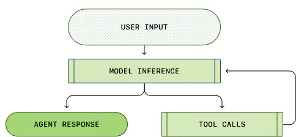
  <figcaption>fig-01-codex-agent-loop</figcaption>
</figure>
```

## fig-02-coding-agent-tools.png

```html
<figure>
  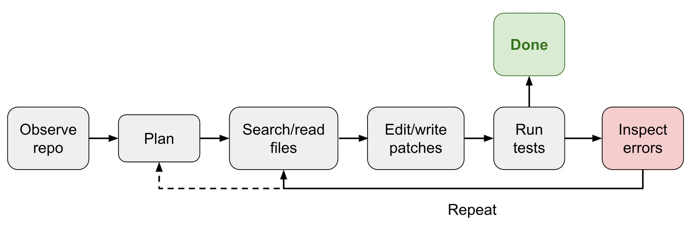
  <figcaption>fig-02-coding-agent-tools</figcaption>
</figure>
```

## fig-03-ace-framework.png

```html
<figure>
  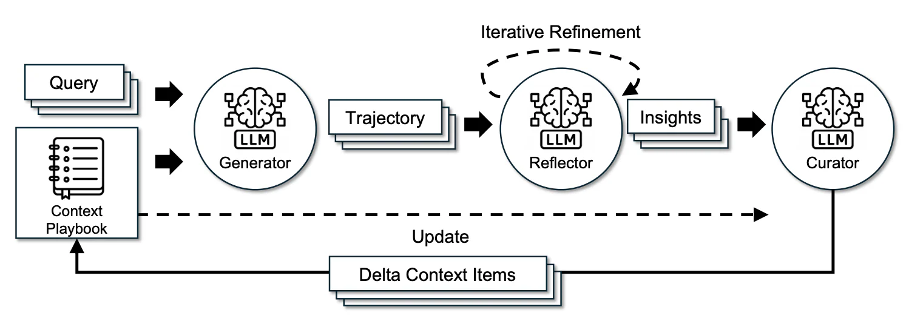
  <figcaption>fig-03-ace-framework</figcaption>
</figure>
```

## fig-04-mce-framework.png

```html
<figure>
  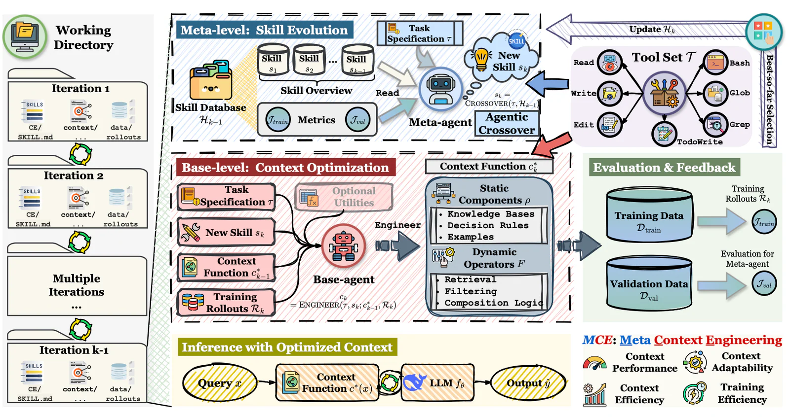
  <figcaption>fig-04-mce-framework</figcaption>
</figure>
```

## fig-05-meta-harness-loop.png

```html
<figure>
  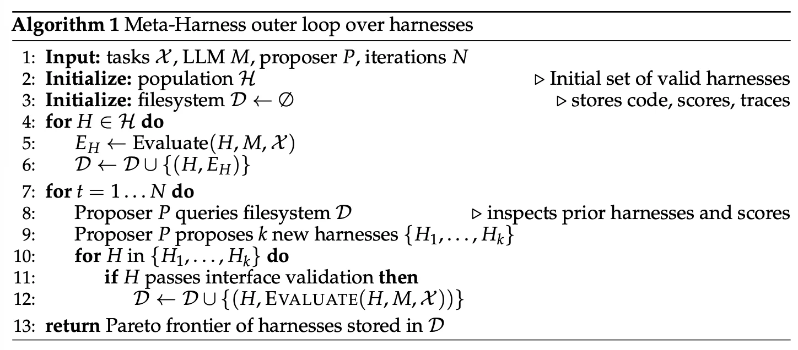
  <figcaption>fig-05-meta-harness-loop</figcaption>
</figure>
```

## fig-06-meta-harness-results.png

```html
<figure>
  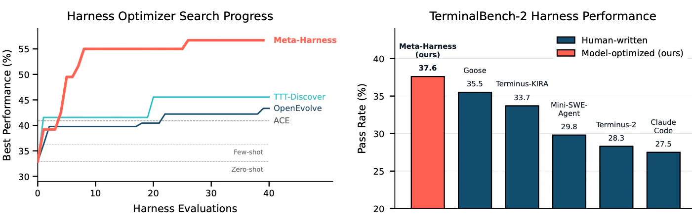
  <figcaption>fig-06-meta-harness-results</figcaption>
</figure>
```

## fig-07-ai-scientist-pipeline.png

```html
<figure>
  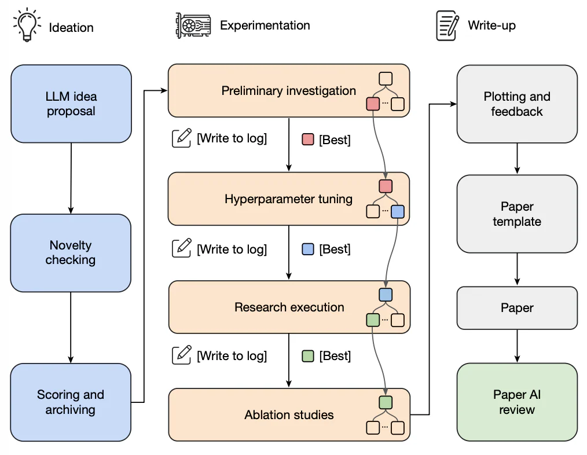
  <figcaption>fig-07-ai-scientist-pipeline</figcaption>
</figure>
```

## fig-08-autodata-workflow.png

```html
<figure>
  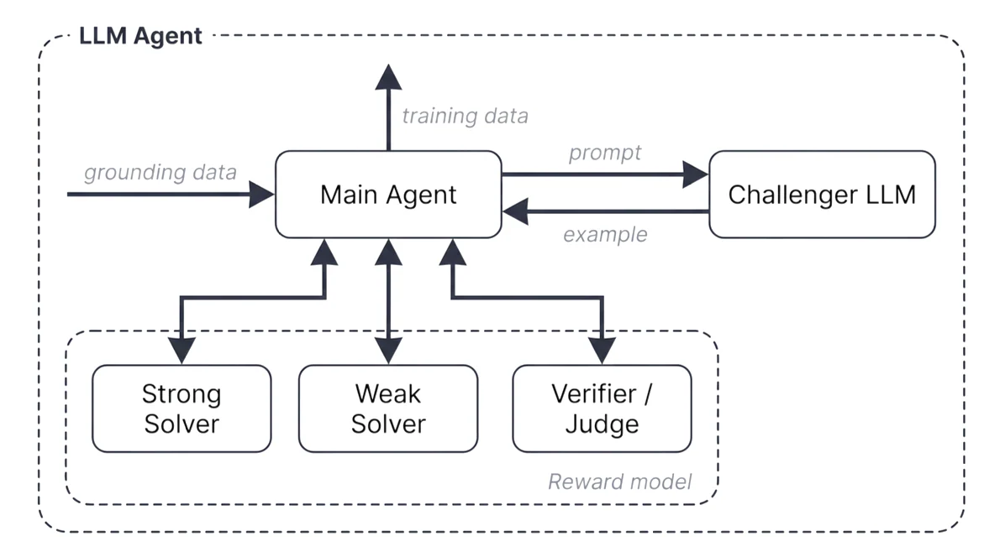
  <figcaption>fig-08-autodata-workflow</figcaption>
</figure>
```

## fig-09-adas.png

```html
<figure>
  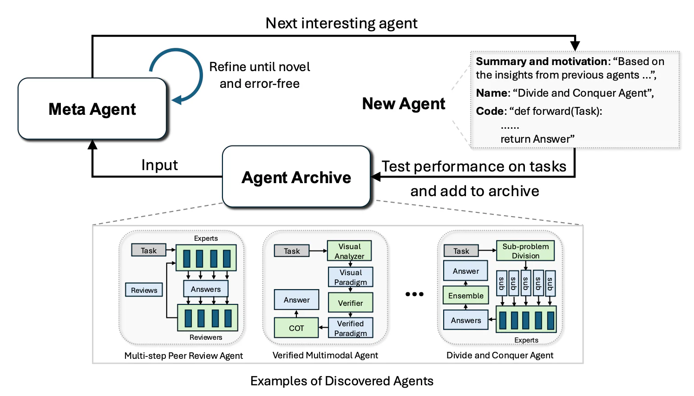
  <figcaption>fig-09-adas</figcaption>
</figure>
```

## fig-10-aflow-optimization.png

```html
<figure>
  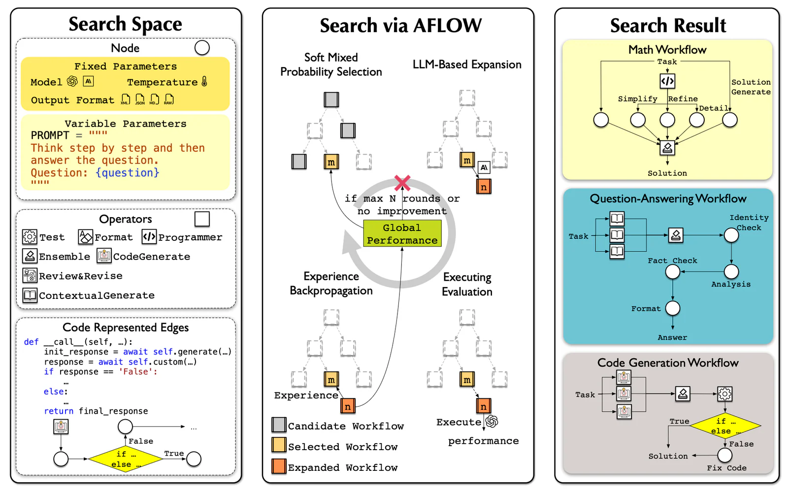
  <figcaption>fig-10-aflow-optimization</figcaption>
</figure>
```

## fig-11-aflow-results.png

```html
<figure>
  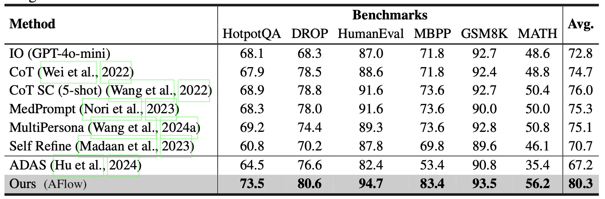
  <figcaption>fig-11-aflow-results</figcaption>
</figure>
```

## fig-12-stop-algorithm.png

```html
<figure>
  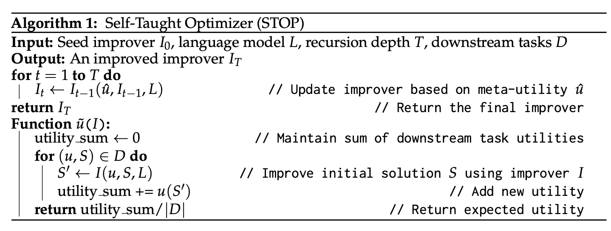
  <figcaption>fig-12-stop-algorithm</figcaption>
</figure>
```

## fig-13-stop-strategies.png

```html
<figure>
  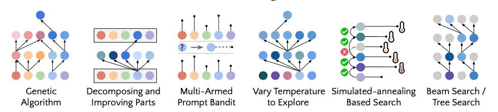
  <figcaption>fig-13-stop-strategies</figcaption>
</figure>
```

## fig-14-harness-capability-results.png

```html
<figure>
  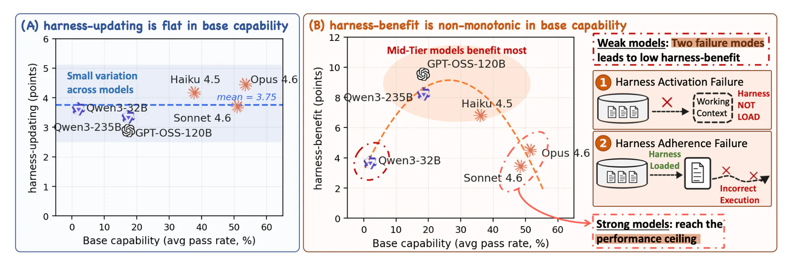
  <figcaption>fig-14-harness-capability-results</figcaption>
</figure>
```

## fig-15-self-harness-loop.png

```html
<figure>
  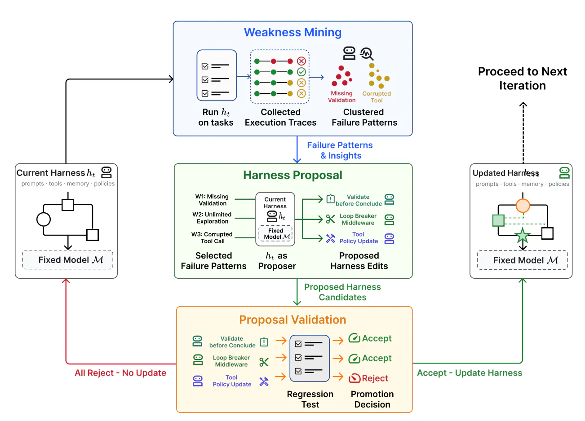
  <figcaption>fig-15-self-harness-loop</figcaption>
</figure>
```

## fig-16-alphaevolve.png

```html
<figure>
  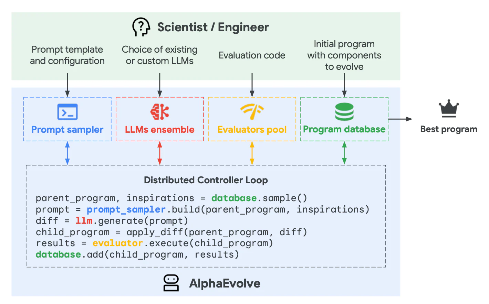
  <figcaption>fig-16-alphaevolve</figcaption>
</figure>
```

## fig-17-alphaevolve-ablations.png

```html
<figure>
  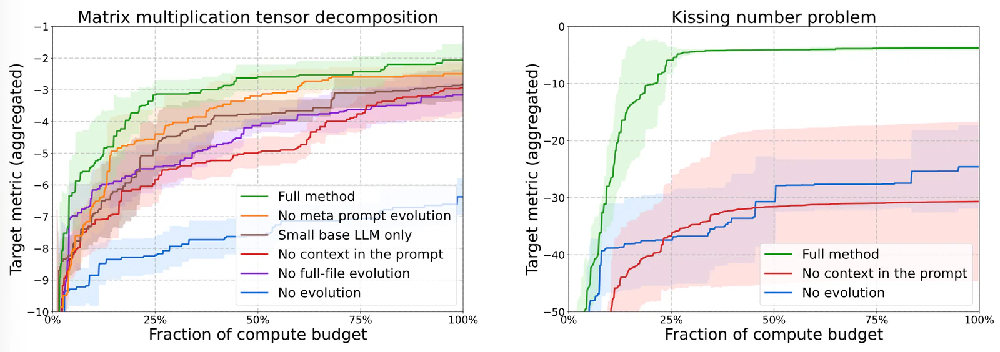
  <figcaption>fig-17-alphaevolve-ablations</figcaption>
</figure>
```

## fig-18-sia-feedback-agent.png

```html
<figure>
  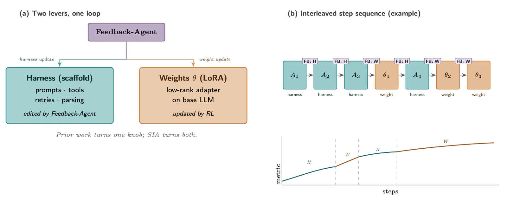
  <figcaption>fig-18-sia-feedback-agent</figcaption>
</figure>
```
