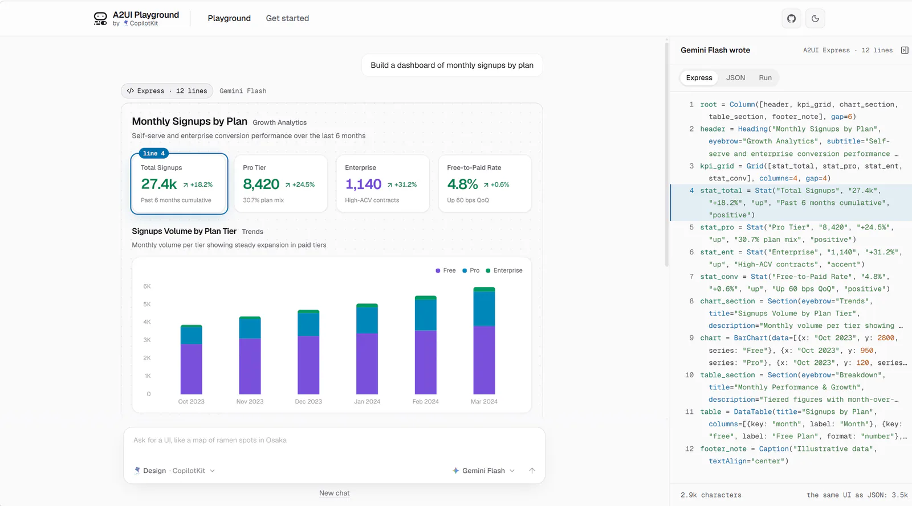

传统聊天机器人主要返回文字。用户如果想修改对应前端界面，通常还要在聊天窗口之外寻找对应页面。A2UI 想解决的问题是：**让 Agent 用一套受控的组件协议描述界面，再由客户端把这些描述渲染成真正的交互控件。**

A2UI 不是网页生成器，也不是一个新的前端框架。它更接近“Agent 时代的声明式 UI 协议”：模型决定当前需要什么界面，SDK 负责生成和校验协议消息，客户端负责映射到已有组件。通俗点来讲，就是在组件库和前端展示之间加了一层映射，用户可以根据所选组件去进行对应修改。

<figure>
  
  <figcaption>A2UI Playground 中，左侧是根据自然语言生成的仪表盘，右侧是对应的 A2UI Express 声明。模型描述组件、属性和数据关系，由客户端渲染成真实界面。</figcaption>
</figure>

## 先说结论

A2UI 的核心链路是：

```text
用户意图
  ↓
Agent 调用模型
  ↓
模型根据 Catalog 生成 UI 声明
  ↓
A2UI SDK 编译和校验
  ↓
JSON 消息
  ↓
客户端 Renderer 渲染组件
  ↓
用户操作作为 Action 返回 Agent
```

它带来的主要能力是：

- 根据上下文动态组合界面。
- 只开放应用允许使用的组件和属性。
- 支持组件树更新、数据绑定和用户操作回传。
- 让同一套 Agent 输出适配不同客户端或不同组件体系。
- 避免把模型生成的 HTML、JavaScript 或任意 React/Vue 代码直接执行。

它不负责：

- 自动生成完整网站。
- 自动扫描并复用项目中任意现有组件。
- 直接修改前端源码。
- 代替数据库、权限系统或业务接口。
- 保证任意视觉设计都能精确还原。

## 为什么需要 A2UI

纯文本界面适合解释和问答，但很多任务天然需要结构化交互，例如：

- 选择日期和人员。
- 填写一组参数。
- 对比多个方案。
- 确认有风险的操作。
- 分步骤完成一项任务。
- 展示进度、错误和最终结果。

如果让模型直接生成 HTML 或 JavaScript，会带来几个问题：

1. 安全边界不清晰。
2. 样式和交互难以保持一致。
3. 不同客户端难以复用。
4. 模型输出的结构难以可靠校验。
5. 前端组件和业务能力容易被模型绕过。

A2UI 的做法是先定义组件 Catalog，再把模型限制在这个白名单中。模型描述“要显示什么”和“组件之间怎样组合”，但不直接控制浏览器执行什么代码。

## 核心概念

| 概念 | 含义 |
| --- | --- |
| Catalog | 当前客户端支持的组件、属性和函数清单 |
| Surface | 一块独立的动态 UI 区域 |
| Component | Surface 中的一个逻辑组件节点 |
| Component ID | 组件在组件树中的逻辑标识，不是 DOM 选择器 |
| Data Model | 表单、选项、列表等界面数据 |
| Action | 用户点击、提交或选择后回传给 Agent 的事件 |
| Renderer | 把 A2UI 消息映射成真实 React、Flutter 等组件的客户端 |
| Processor | 接收协议消息、校验并维护 Surface 状态的前端处理器 |

可以把 A2UI 的“定位”理解为逻辑定位：

```text
surfaceId      定位一块动态界面
componentId    定位组件树中的一个节点
parent/children 描述节点之间的层级
data path      定位一项界面数据
```

它不使用 CSS Selector 查找 DOM，也不会告诉代码编辑器修改某个源文件。客户端收到更新消息后，由 Renderer 找到对应的 Surface 和 Component，再重新渲染。

## Catalog 决定能力范围

Catalog 是 A2UI 最重要的边界。它声明客户端愿意接受哪些组件、属性和动作。

例如，一个很小的 Catalog 可以只包含：

```text
Text
Button
TextField
Card
Column
```

模型可以组合出标题、说明、输入框和提交按钮，但不能使用没有注册的图表、地图或视频组件。

如果应用需要自己的业务组件，例如“素材审核卡”或“商品对比表”，需要同时完成三件事：

1. 在 Catalog 中声明组件名、属性和数据结构。
2. 实现真实的前端组件。
3. 在 Renderer 中建立 A2UI 组件到真实组件的映射。

因此，“复用现有组件”是正确的，但这是有条件的复用：组件必须经过封装、注册和映射，A2UI 不会自己识别项目中的任意组件文件。

## 常见消息

A2UI 的协议会围绕 Surface 的创建、组件更新、数据更新和用户动作展开。实际字段应以所锁定的协议版本为准，整体思路如下：

```json
{
  "surfaceId": "profile-form",
  "components": [
    {
      "id": "title",
      "type": "Text",
      "props": {
        "text": "完善个人资料"
      }
    },
    {
      "id": "name",
      "type": "TextField",
      "props": {
        "label": "姓名",
        "value": {
          "path": "/name"
        }
      }
    },
    {
      "id": "save",
      "type": "Button",
      "props": {
        "label": "保存",
        "action": {
          "name": "saveProfile"
        }
      }
    }
  ]
}
```

前端 Renderer 在内部把这些声明映射成：

```text
Text       → 项目中的文本组件
TextField  → 项目中的输入组件
Button     → 项目中的按钮组件
```

模型更新界面时，可以增加组件、修改属性、调整组件树或更新数据模型。它仍然只能在 Catalog 允许的范围内操作。

## 快速开始

### 方式一：先运行官方示例

官方仓库包含完整示例和可运行客户端，适合用来观察协议消息与实际渲染效果。

```powershell
git clone https://github.com/a2ui-project/a2ui.git
cd a2ui
Get-Content README.md
```

仓库和示例会持续更新，因此先阅读 README，确认当前推荐使用的客户端示例、Node 版本和包管理器，再进入对应目录安装依赖。示例主要用于理解：

- Catalog 如何定义。
- 模型输出如何转换成 A2UI 消息。
- 客户端如何维护 Surface。
- 用户 Action 如何返回 Agent。

如果只是想体验 A2UI，不建议从完整业务示例开始。先找到最小的基础 Catalog 示例，确认一条 `createSurface` 或组件更新消息能够显示出来。

### 方式二：从空项目搭一个最小应用

推荐的最小组合是：

```text
浏览器 React Renderer
        │ Action / 用户消息
        ▼
Python FastAPI Agent
        │
        └── A2UI 消息 + SSE ──> 浏览器
```

本地开发时启动两个进程：

- FastAPI：`127.0.0.1:8080`
- Vite：`127.0.0.1:5173`

Vite 把 `/api` 代理到 FastAPI。生产环境可以先构建前端，再由 FastAPI 托管静态文件，最终只暴露一个端口。

## 本地项目部署实践

下面是一套不依赖特定业务示例的最小实践。它使用 BasicCatalog、Python Agent、React Renderer 和 SSE。

### 1. 项目结构

```text
a2ui-local/
├─ server/
│  ├─ app/
│  │  ├─ main.py
│  │  ├─ model.py
│  │  └─ session.py
│  └─ requirements.txt
├─ web/
│  ├─ src/
│  │  ├─ App.tsx
│  │  ├─ agent-client.ts
│  │  └─ AgentSurface.tsx
│  ├─ vite.config.ts
│  └─ package.json
└─ README.md
```

### 2. 安装 Python 依赖

建议在虚拟环境中锁定 A2UI SDK 和其他依赖的版本：

```powershell
python -m venv .venv
.\.venv\Scripts\Activate.ps1

python -m pip install fastapi uvicorn openai a2ui-agent-sdk
python -m pip freeze > requirements.txt
```

A2UI SDK 的 API 仍在演进。项目中不要只写宽松版本范围，应把实际验证通过的版本写入 `requirements.txt`。

### 3. 初始化 A2UI Generator

首版直接使用 `BasicCatalog`，不要先设计自定义组件。Generator 负责把 Catalog 信息加入系统提示词，并对模型输出进行编译和校验。

```python
from a2ui.core.basic_catalog import BasicCatalog
from a2ui.core.schema import ProtocolVersion
from a2ui.inference_formats import ExpressFormatFactory
from a2ui.processor import A2uiGenerator, CatalogConfig

catalogs = [BasicCatalog(ProtocolVersion.V1_0)]

generator = A2uiGenerator(
    catalogs=[
        CatalogConfig(catalog=catalog)
        for catalog in catalogs
    ],
    inference_format_factory=ExpressFormatFactory(),
)
```

每个会话都需要独立的 `RendererState`：

```python
from a2ui.utils import RendererState

state = RendererState(catalogs)

processor = generator.create_processor(
    {
        "1.0": {
            "supportedCatalogIds": [
                catalog.catalog_id
                for catalog in catalogs
            ],
        },
    },
    state=state,
)

system_prompt = (
    "你是一个界面 Agent。当交互界面比纯文本更合适时，"
    "返回 A2UI。只使用当前 Catalog 中存在的组件。\n\n"
    f"{processor.prompt_snippet}"
)
```

同一浏览器会话后续更新组件时，必须复用同一个 `state`。如果每次请求都创建新状态，后续更新可能找不到之前的 Surface。

本地演示可以先用字典保存会话：

```python
sessions: dict[str, RendererState] = {}
```

生产环境应改为 Redis 或其他共享存储，并设置过期时间和并发保护。

### 4. 流式调用模型

A2UI 与模型供应商解耦。只要适配层能输出文本流，就可以接入 OpenAI、Gemini、DeepSeek 或其他兼容模型。

下面使用 OpenAI 兼容接口作为示例：

```python
import os

from openai import AsyncOpenAI

client = AsyncOpenAI(
    api_key=os.environ["LLM_API_KEY"],
    base_url=os.environ.get("LLM_BASE_URL"),
)


async def call_model(system_prompt: str, user_message: str):
    response = await client.chat.completions.create(
        model=os.environ["LLM_MODEL"],
        messages=[
            {
                "role": "system",
                "content": system_prompt,
            },
            {
                "role": "user",
                "content": user_message,
            },
        ],
        stream=True,
    )

    async for chunk in response:
        text = chunk.choices[0].delta.content
        if text:
            yield text
```

如果模型提供商使用不同的接口，只需要替换 `call_model`。前端 Renderer、Catalog 和 A2UI 消息格式不应跟着改变。

如果还需要工具调用，适配层必须额外处理：

- 区分普通文本和 `tool_calls`。
- 拼接分片的工具参数。
- 把工具结果重新送回模型。
- 限制工具循环轮数、总时长和最大费用。
- 记录模型和工具调用结果。

首版先不要加入工具调用，这样可以单独验证 A2UI 链路。

### 5. 把模型流交给 A2UI Processor

模型返回的内容不能直接发给前端当 HTML 使用。它要先进入 A2UI Processor，生成经过校验的协议消息。

```python
stream = processor.open_stream()

async for chunk in call_model(system_prompt, user_message):
    for part in stream.feed(chunk):
        # SDK 版本不同，A2uiPart 的导入位置和类型判断方式可能不同。
        # 只转发包含 A2UI 消息的 part。
        if is_a2ui_part(part):
            for message in part.a2ui:
                yield message

for part in stream.close():
    if is_a2ui_part(part):
        for message in part.a2ui:
            yield message
```

实际项目中应从锁定版本的 SDK 导入 `A2uiPart`，不要把这里的 `is_a2ui_part` 当作正式辅助函数。

### 6. 用 SSE 返回消息

首版用 SSE 就足够。用户提交消息时使用 `POST + fetch`，因为：

- 请求体可以携带会话 ID 和用户文本。
- 可以发送认证 Header。
- 不需要把敏感信息放进 URL。
- 服务端可以持续推送多个 A2UI 消息。

浏览器原生 `EventSource` 只支持 GET，因此复杂请求通常使用 `fetch` 读取 `ReadableStream`。

后端发送前要序列化为协议 JSON：

```python
import json


def to_sse(message) -> str:
    payload = message.model_dump(
        by_alias=True,
        exclude_unset=True,
    )
    text = json.dumps(payload, ensure_ascii=False)
    return f"data: {text}\n\n"
```

FastAPI 路由示意：

```python
from fastapi import FastAPI
from fastapi.responses import StreamingResponse
from pydantic import BaseModel

app = FastAPI()


class AgentRequest(BaseModel):
    session_id: str
    message: str


@app.post("/api/agent")
async def agent(request: AgentRequest):
    async def events():
        async for message in run_agent(request):
            yield to_sse(message)

    return StreamingResponse(
        events(),
        media_type="text/event-stream",
        headers={
            "Cache-Control": "no-cache",
            "X-Accel-Buffering": "no",
        },
    )
```

`X-Accel-Buffering: no` 可以避免 Nginx 等反向代理缓存流式响应。

### 7. 接入 React Renderer

创建 React 工程并安装客户端依赖：

```powershell
pnpm create vite web --template react-ts
cd web
pnpm add @a2ui/react @a2ui/web_core @a2ui/markdown-it zod
```

初始化 Markdown 渲染、基础样式和消息处理器：

```tsx
import { renderMarkdown } from "@a2ui/markdown-it";
import {
  MessageProcessor,
  basicCatalog,
  injectBasicCatalogStyles,
  setMarkdownRenderer,
} from "@a2ui/web_core/v1_0";

injectBasicCatalogStyles();
setMarkdownRenderer(renderMarkdown);

export const processor = new MessageProcessor(
  [basicCatalog],
  (action) => {
    fetch("/api/agent", {
      method: "POST",
      headers: {
        "Content-Type": "application/json",
      },
      body: JSON.stringify({
        session_id: "demo",
        action,
      }),
    });
  },
);
```

渲染时，普通聊天文字由自己的页面负责，A2UI 只负责动态区域：

```tsx
import { A2uiSurface } from "@a2ui/react";

export function AgentSurface({ surfaces }) {
  return surfaces.map((surface) => (
    <A2uiSurface
      key={surface.id}
      surface={surface}
    />
  ));
}
```

不同 SDK 版本暴露 Surface 状态的方式可能不同。以锁定版本的类型定义为准，但职责始终是：

1. 接收服务端 JSON。
2. 经过 `MessageProcessor` 校验。
3. 更新 Surface 和 Data Model。
4. 用 `A2uiSurface` 渲染。
5. 把 Action 发回后端。

### 8. 配置开发代理

前端不要直接保存模型 Key。Vite 只负责代理请求：

```ts
export default defineConfig({
  server: {
    proxy: {
      "/api": "http://127.0.0.1:8080",
    },
  },
});
```

密钥放在后端环境变量中：

```powershell
$env:LLM_API_KEY = "your-api-key"
$env:LLM_BASE_URL = "https://api.example.com/v1"
$env:LLM_MODEL = "your-model"
```

不要使用 `VITE_LLM_API_KEY`。所有以 `VITE_` 开头的变量都会被构建进浏览器资源。

### 9. 启动本地服务

终端一：

```powershell
cd server
.\.venv\Scripts\Activate.ps1
uvicorn app.main:app --host 127.0.0.1 --port 8080 --reload
```

终端二：

```powershell
cd web
pnpm dev
```

打开 Vite 输出的地址，先验证纯文本对话，再验证 A2UI Surface，最后测试按钮 Action。

### 10. 生产部署

构建前端：

```powershell
cd web
pnpm build
```

让 FastAPI 先注册 `/api` 路由，再托管 `web/dist`：

```python
from fastapi.staticfiles import StaticFiles

# API 路由必须放在静态文件挂载之前
app.mount(
    "/",
    StaticFiles(directory="../web/dist", html=True),
    name="web",
)
```

最终可以用一个 FastAPI 进程和一个访问端口部署。但浏览器中仍然运行 Renderer，所以“一个访问地址”不等于“只有一个技术组件”。

生产环境还要补充：

- 用户登录和会话鉴权。
- Action 的服务端权限校验。
- Catalog 和协议版本管理。
- 会话 TTL、并发锁和断线恢复。
- SSE 超时、取消和模型费用限制。
- 日志脱敏、限流和错误监控。
- 模型不可用时的普通表单或文本降级。

## AI 到底能改什么

在运行时，Agent 可以根据用户意图修改允许范围内的界面：

- 添加、删除或移动组件。
- 修改标题、说明和按钮文字。
- 根据数据决定显示卡片、表格或列表。
- 创建筛选器、确认框和多步骤表单。
- 更新表单默认值、选项和校验提示。
- 根据任务状态显示进度、错误和结果。
- 根据 Action 更新已有 Surface。

例如用户说：

> 把结果改成表格，并增加一个“只看失败项”的筛选器。

只要 Catalog 中存在 Table、Checkbox 等组件，Agent 就可以返回新的组件树。前端无需重新部署。

但 Agent **不能**直接：

- 生成任意 HTML。
- 执行模型生成的 JavaScript。
- 修改 React 或 Vue 源文件。
- 创建 Catalog 中不存在的组件。
- 使用未声明的组件属性。
- 绕过业务后端的权限检查。
- 直接访问数据库、文件系统或任意网络。
- 理解页面全部 DOM 并随意调整 CSS。

Action 也不是自动执行。按钮点击只是产生一个事件，真正的删除、支付、上传等操作仍要调用普通后端接口，并经过身份、权限和状态校验。

## 能力边界

| 场景 | 适合程度 | 原因 |
| --- | --- | --- |
| Agent 动态筛选面板 | 高 | 组件少、交互结构明确 |
| 任务确认和参数收集 | 高 | 适合表单、按钮和状态更新 |
| 根据结果展示卡片或表格 | 高 | 结构化数据容易映射 |
| 多步骤工作流 | 高 | Surface 可持续更新 |
| 不同客户端复用同一类交互 | 高 | Catalog 和 Renderer 负责适配 |
| 高度定制的品牌官网 | 低 | 依赖精确布局、动画和视觉控制 |
| 复杂可视化编辑器 | 中低 | 需要大量自定义组件和状态协议 |
| 直接生成并部署网页 | 不适合 | A2UI 不是代码生成或建站工具 |
| 替代业务后端 | 不适合 | 协议不提供业务权限和数据能力 |

它不是“AI 万能画页面”。更准确的理解是：

> 应用把所有可组合的 UI 能力预先开放给 Agent，Agent 只在白名单中决定怎样组合、何时更新，以及如何把用户操作返回业务流程。

## 实践建议

1. **从 BasicCatalog 开始。** 先跑通渲染、流式消息和 Action，再做自定义组件。
2. **把聊天和动态 UI 分开。** 普通文字仍由聊天组件显示，A2UI Surface 只承载结构化交互。
3. **Catalog 要小。** 只暴露真实需要、可维护、可授权的组件。
4. **ID 要保持稳定。** 同一个逻辑组件的 `componentId` 不应随请求随机变化。
5. **状态放在服务端。** 同一个会话复用 RendererState，并为状态设置 TTL。
6. **Action 必须重新鉴权。** 前端传来的组件上下文不能被视为可信权限。
7. **锁定依赖版本。** A2UI 仍处于快速发展阶段，SDK、协议和示例 API 可能变化。
8. **准备降级路径。** 模型超时或输出校验失败时，回退到普通表单或固定页面。
9. **用固定消息测试 Renderer。** 在不调用模型的情况下手工发送 A2UI JSON，可以先定位客户端问题。
10. **记录协议消息。** 调试时记录 Catalog 版本、消息类型、Surface ID 和校验错误，但不要记录密钥和敏感表单数据。

## 资源

- [A2UI 1.0 官方介绍：Build delightful, fast, reliable agentic experiences](https://developers.googleblog.com/a2ui-10-build-delightful-fast-reliable-agentic-experiences/)
- [A2UI GitHub 仓库](https://github.com/a2ui-project/a2ui)
- [A2UI 官方文档](https://a2ui.org/)
- [A2UI 项目概览](https://a2ui.org/concepts/overview/)
- [Agent 集成指南](https://a2ui.org/guides/agent-integration/)
- [客户端集成指南](https://a2ui.org/guides/client-integration/)

A2UI 最值得关注的地方，不是让模型多了一种输出格式，而是给 Agent 的动态界面建立了一条可校验、可复用、可授权的边界。界面仍然属于应用，模型获得的是在受控 Catalog 中编排界面的能力。
