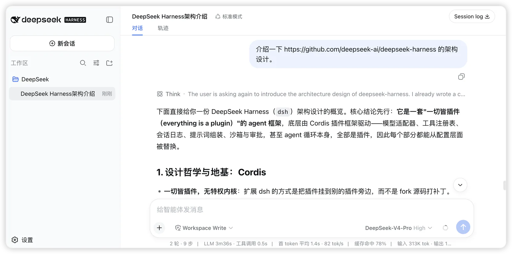
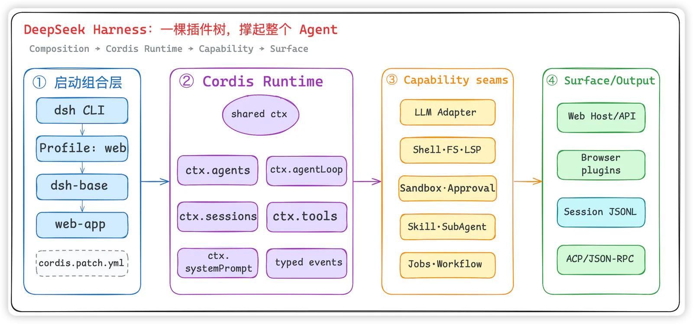
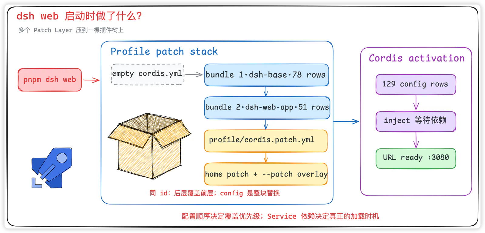
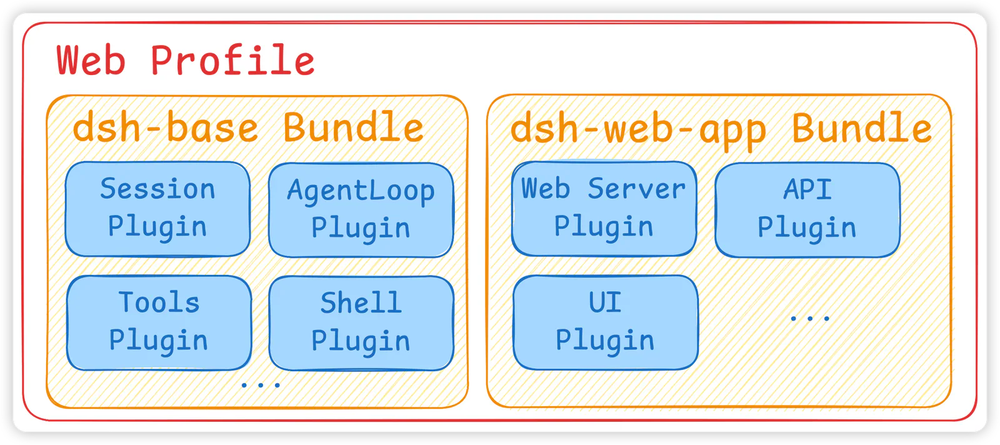
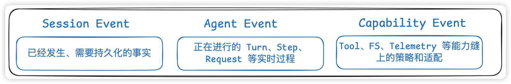
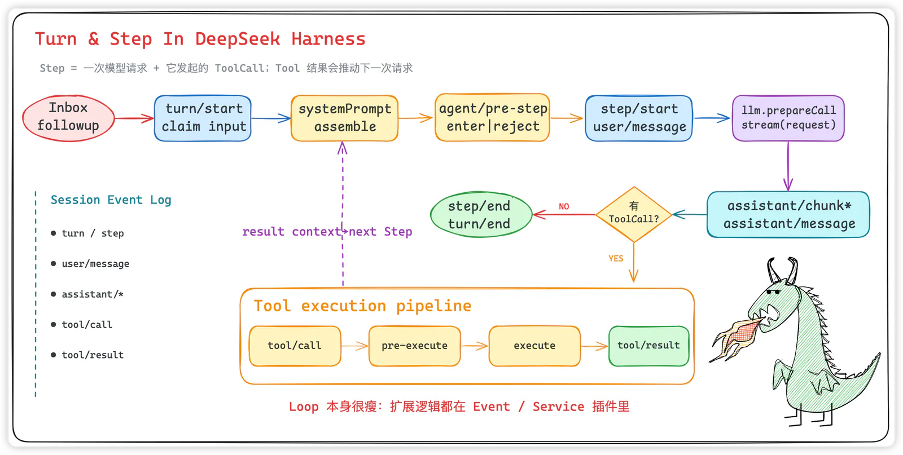
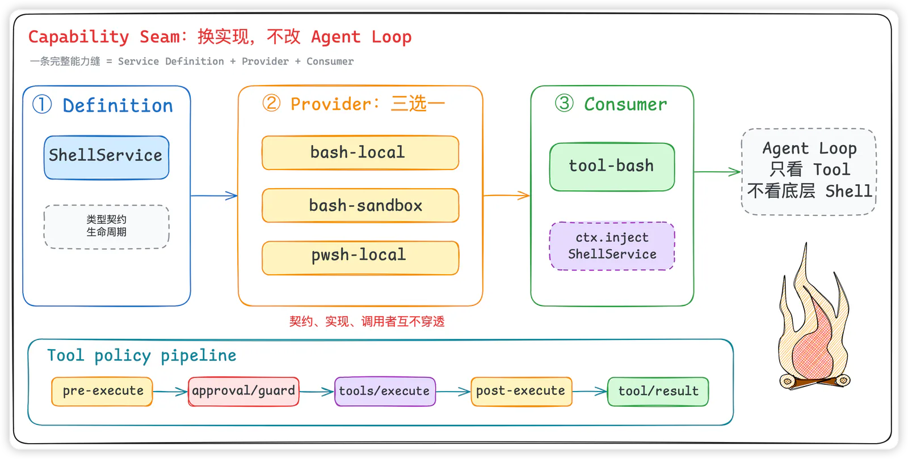
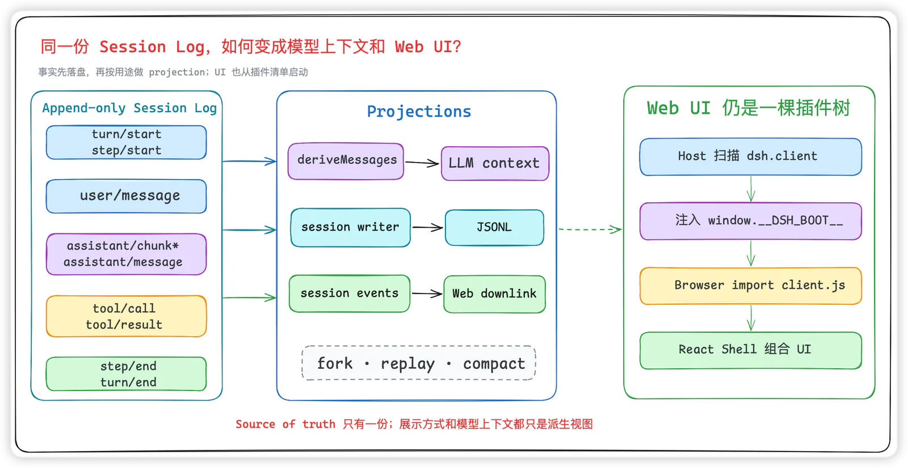

第一次打开 DeepSeek Harness（下面简称 DSH）的仓库，很容易被几十个包名劝退：`agent-loop`、`session`、`sandbox`、`bundle`、`llm-deepseek`、`client`、`host`……看起来像一堆零件，而且每个零件都有人负责。

但只要换一个角度看，它其实很像一套可以自由拼装的电脑：

- 机箱和应用形态由 `profile` 决定；
- 主板和插槽由 Cordis 提供；
- 模型、工具、沙箱、会话存储是一张张可以更换的扩展卡；
- Agent Loop 负责真正开机运行；
- Session 日志则像一份不会随便涂改的运行记录。

这样看，“一切皆插件”就不再是一句口号，而是 DSH 从启动到执行都遵守的组织方式。

<figure>
  
  <figcaption>DSH 的 Web 界面不只是一个聊天框。顶部可以查看轨迹和 Session 日志，底部会显示轮次、Step、模型调用和缓存等信息。</figcaption>
</figure>

## 一句话理解 DSH

DSH 不是一个“主程序里顺便支持插件”的聊天工具，而是一套由配置组装出来的 Agent 运行环境。

它启动时会先回答三个问题：

1. 这次要运行成 Web、命令行、SDK，还是其他应用形态？
2. 当前配置要装载哪些插件和服务？
3. Cordis 如何根据依赖关系，把它们真正连接起来？

配置决定“装什么”，Cordis 决定“怎么连”，Agent Loop 决定“怎么跑”，Session 记录“到底跑了什么”。把这四件事分开之后，DSH 的包虽然多，但各部分的边界会清楚很多。

<figure>
  
  <figcaption>DSH 可以粗略看成四段：启动组合、Cordis 运行时、能力缝和最终输出界面。每一段都可以单独替换或扩展。</figcaption>
</figure>

## 从一条启动命令开始

体验 DSH 最简单的方式，是运行：

```powershell
npx @deepseek-ai/dsh web
```

终端里看起来只是启动了一个本地 Web 服务，但内部发生的事并不简单。

DSH 不会先写死“Web 版需要哪些功能”，而是先读取一个 `web` profile，再把基础 bundle、Web 应用 bundle 和用户自己的 patch 一层层叠起来。最后得到的是一棵插件树，而不是一大段把所有功能都塞进去的启动代码。

<figure>
  
  <figcaption>`dsh web` 会先把多层配置压成插件树，再交给 Cordis 根据服务依赖激活。图中的配置行数会随版本变化，真正重要的是这套叠加顺序。</figcaption>
</figure>

这里有一个容易踩坑的细节：后加载的 patch 如果命中了同一个配置条目 id，它通常会替换整段 `config`，而不是帮你把新旧对象逐字段合并。

比如默认配置里已经有：

```yaml
endpoint: https://example.test
retries: 3
```

你不能假设只写一个 `retries: 5` 就能保留原来的 `endpoint`。修改配置之前，最好先查看完整的默认条目，再写清楚目标状态下需要的完整配置。

这也说明了一件事：在 DSH 里，配置不是无关紧要的附属文件，它本身就是应用的一部分。

## Bundle 和 Profile 有什么区别？

可以把 Bundle 理解成“一套已经配好的零件包”，Profile 则是“这次实际装出来的整机方案”。

以 Web 形态为例：

<figure>
  
  <figcaption>基础 bundle 负责 Agent、Session、工具和 Shell 等通用能力，Web 应用 bundle 再补上 Web Server、API 和 UI。</figcaption>
</figure>

- `base` 负责 Agent 运行所需的通用能力；
- `web-app` 在基础能力上补 Web Server、API 和界面；
- `headless` 去掉浏览器界面，更适合自动化；
- `sdk` 让其他程序可以直接嵌入 DSH；
- `sdk-minimal` 刻意只保留很少的服务，适合做轻量集成；
- `acp` 则面向另一类客户端协议。

Profile 是这些默认层再叠加用户修改后的结果。所以排查问题时，先确认“当前 profile 到底装了什么”，往往比直接翻源码更快。

## Cordis 到底在做什么？

Cordis 经常被一句话带过：“它是一个插件和依赖注入框架。”这话没错，但不够直观。

可以把 Cordis 想成一块带标准插槽的主板。插件插上去以后，主要能做三件事：

1. 提供一种服务，例如让别的插件可以使用 `ctx.llm` 或 `ctx.sandbox`；
2. 监听某种事件，例如会话开始、模型请求或工具执行结束；
3. 注册一组可撤销的资源。插件卸载时，这些监听器和资源也会一起清理。

DSH 中很多关键决策都是通过事件完成的。比如模型请求发出前，插件可以修改 provider、模型或参数；请求失败后，另一个插件可以决定是否重试。

这里要分清“看见”和“接管”：

- 普通监听器适合记录日志、统计指标；
- `waterfall` 事件允许插件参与决策，并把新的结果交给下一层；
- 替换 Service 则会改变一项能力的完整实现。

不过，Cordis 只负责把插件连接起来，它不负责 Turn 怎么结束、工具是否需要批准、Session 如何恢复。那些仍由 DSH 自己的 Agent、工具、沙箱和会话系统处理。

## 三类事件，各管一件事

DSH 的事件很多，但可以先按职责分成三类：

<figure>
  
  <figcaption>Session Event 记录已经发生的事实，Agent Event 描述正在运行的流程，Capability Event 关注工具、文件系统和遥测等能力层的适配。</figcaption>
</figure>

- **Session Event**：已经发生、值得长期保留的事实，例如用户消息、模型回复和工具结果；
- **Agent Event**：正在进行的 Turn、Step、模型请求及其状态变化；
- **Capability Event**：工具、文件系统、遥测等具体能力上的事件。

这样拆开以后，日志不会被 UI 状态淹没，能力插件也不用理解整个 Agent 的生命周期。

## 一次对话是怎样跑完的？

用户看到的是一问一答，DSH 内部跑的却是一个循环。

假设你对 Agent 说：“帮我修复测试并提交。”

1. Agent 先读取代码，发起第一次模型请求；
2. 模型要求读取文件，系统执行工具并记录结果；
3. 模型根据结果修改代码；
4. Agent 再请求模型，随后运行测试；
5. 测试失败，继续修复；
6. 测试通过，完成提交，当前 Turn 结束。

这里的两个词很重要：

- **Turn**：从领取一次用户输入开始，到暂时没有后续工作为止；
- **Step**：一次模型请求，以及由它产生的工具调用和工具结果。

所以上面这次任务虽然只算一个 Turn，却包含多个 Step。

<figure>
  
  <figcaption>模型流式返回结果后，如果提出 ToolCall，就进入工具执行流水线；工具结果再推动下一次 Step。</figcaption>
</figure>

DSH 的 Agent Loop 本身并不想做所有事情。它的责任是组织请求、驱动 Step 和判断是否继续；具体决策则尽量留给事件和 Service 插件。这也是为什么主循环可以保持相对简单。

## 工具为什么不是“直接调用一个函数”？

从模型角度看，工具调用像是一句“请读取这个文件”或“请运行这条命令”。但在真实环境里，一次工具调用还要经过很多检查：

1. 工具是否存在；
2. 参数是否符合格式；
3. 当前 Agent 是否声明了这项工具；
4. 权限策略是否允许；
5. 是否需要用户确认；
6. 路径或命令是否超出工作区；
7. 执行是否超时；
8. 输出是否需要截断；
9. 结果如何写回 Session。

如果这些逻辑散落在每个工具里，最后每个工具都会有自己的一套规则。DSH 把这些公共步骤放进工具流水线，具体工具只负责自己的业务语义。

## 能力缝：换掉实现，不影响调用者

DSH 经常出现一个词：**capability seam**，可以理解成“能力缝”或“可替换能力的接口边界”。

一条完整的能力缝通常包含三部分：

- 一份服务定义，说明这项能力能做什么；
- 一个或多个 Provider，负责真正实现它；
- 一些 Consumer，只依赖接口，不关心底层是谁实现。

<figure>
  
  <figcaption>以 Shell 为例，工具只需要使用 ShellService。底层换成本地 bash、带沙箱的 bash 或 PowerShell，不需要修改 Agent Loop。</figcaption>
</figure>

这套模式不只用于 Shell，也用于模型、Session、文件系统、存储和子 Agent。

它的好处很实际：

- 换模型 provider，不需要改 Session 格式；
- 换会话存储，不需要改工具协议；
- 把本地 Shell 换成容器或远程执行器，不需要让每个工具知道底层差异；
- 测试时可以注入一个假实现，不用真的启动模型或执行命令。

## Scope 不是安全沙箱

DSH 可以让同一个进程运行多个 Agent。每个 Agent 可以有独立的 Scope，决定它能看见哪些工具、提示词片段和变量。

A Agent 注册的东西不会自动进入 B Agent 的视图，这叫可见性隔离。

但“看不见”不等于“碰不到”。Scope 不是安全边界。真正限制进程访问文件、网络和系统资源的是 sandbox、Shell、文件系统 Provider 和审批策略。

这几层职责可以这样记：

- Scope 管模型看得见什么；
- sandbox 管进程实际能操作什么；
- approval 管某次敏感操作是否需要人工确认；
- credentials 管凭据以什么方式提供给程序。

## Session 日志为什么重要？

一般的聊天应用只保存消息列表。DSH 保存的是一条 append-only 的 Session 事件日志。

“append-only”的意思是：新事实只往后追加，原有事件不随便改写。这样做的目的不是把日志做得很复杂，而是让下面这些事情都使用同一份事实来源：

- Web UI 展示对话；
- 模型组装下次请求；
- 应用崩溃后恢复；
- 重放某次执行；
- 做压缩和摘要；
- 后续审计与测试。

<figure>
  
  <figcaption>原始日志只有一份。模型上下文、JSONL 持久化和 Web UI 都是根据同一份事件派生出来的视图。</figcaption>
</figure>

DSH 有一条很关键的原则：

> 模型能看见的内容，都应该能从 Session 日志里重新得到。

因此，日志里不只有用户消息和模型回复，还会记录 `request/header`、工具调用、工具结果、错误、重试和中断恢复信息。否则，你就无法解释模型当时到底看到了什么，也就很难复盘一次奇怪的行为。

## 为什么不把全部上下文每轮重发？

每进入一个新的 Step，Agent 仍然会重新组装上下文，但“重新组装”不等于“把所有内容重新追加一遍”。

可以把它分成两部分：

- 相对稳定的内容，例如 Agent 指令、Skill 目录、persona 和工具说明；
- 每一步都可能变化的内容，例如用户刚发的消息、新的工具结果和运行时状态。

稳定部分如果没有变化，可以复用上一次的请求结构；只有真的变了，才追加新的请求头。

这样做有两个好处：Session 不会因为重复文本不断膨胀，模型服务也更容易复用稳定的请求前缀，从而提高 KV Cache 的命中率。

当上下文真的接近上限时，DSH 再通过 compaction 生成摘要。摘要属于派生数据，原始 Session 才是事实来源，两者不能混为一谈。

## Web UI 为什么也能算插件？

DSH 的 Web 形态采用“宿主进程 + 浏览器客户端”的结构：

- 宿主侧运行 Agent、Session、工具和沙箱；
- 浏览器侧负责聊天、轨迹、审批和设置界面；
- 两边通过 API 和事件通信；
- 客户端插件再根据清单加载自己的 `client.js`。

所以 Web 扩展并不一定要修改一个巨大的 React 主包。某项能力可以同时包含宿主服务插件、浏览器 UI 插件和两边共享的协议类型。

不过，浏览器插件仍然只能在浏览器安全边界内运行。它扩展的是界面，不会因为在客户端加载就获得宿主进程权限。

## 想知道当前装了什么，可以这样看

排查 DSH 问题时，先看当前 profile，而不是凭包名猜。

```powershell
dsh web --dump-config
```

它会展示最终组合树，并告诉我们某个条目来自哪个 bundle、是否被用户 patch 覆盖。

```powershell
dsh web --dump-default-config
```

它会展示默认 bundle 层，适合和当前配置做对比。

一个比较顺手的排查顺序是：

1. 现在启动的是哪个 profile？
2. 目标插件有没有被装载？
3. 它来自哪个 bundle？
4. 用户 patch 有没有覆盖它？
5. 它需要的 Service 是否已经存在？
6. 某次行为是被事件拦截了，还是 Provider 本身有问题？
7. 最终失败发生在模型、工具、权限、沙箱还是宿主机？

## 想扩展 DSH，应该改哪里？

大多数需求不需要直接改核心源码，可以先按下面的顺序判断：

| 想做的事情 | 优先修改的位置 |
| --- | --- |
| 增加一个工具 | 写工具插件 |
| 替换模型服务 | 写新的 LLM Provider |
| 改变某个 Agent 的人格和工具集 | 新建 Agent Preset |
| 组合出新的 Web、CLI 或 SDK 形态 | 写 Bundle 和 Profile |
| 换本地 Shell、文件系统或沙箱 | 写新的能力 Provider |
| 增加会话存储方式 | 写 Session Provider |
| 调整默认参数 | 修改 Profile patch |

有一条简单原则：**能用 Provider 解决，就不要改消费者；能用 Preset 或 Profile 解决，就不要改核心包。**

## 这套设计也有代价

DSH 看起来很灵活，但灵活并不免费。

### 调试链路更长

一个工具失败，可能是工具本身、参数校验、Scope 可见性、审批、沙箱、模型返回或 profile 没装载。只看某一个函数通常不够，需要结合 Session 和最终配置一起判断。

### 配置也需要像代码一样维护

Profile 的加载顺序、patch 的命中 id 和整段替换规则都会改变结果。配置写错和代码写错没有本质区别，所以也要做版本管理、diff 和验证。

### 插件带来的安全风险更大

插件不仅能展示 UI，还可能注册 Service、监听事件和访问宿主能力。生产环境需要限制插件来源、审查代码、控制凭据，并把不可信执行放进容器或远程环境中。

### 开发者预览版仍会变化

包名、配置字段和内部实现都可能调整。本文更适合用来理解 DSH 的设计思路，不应把某个版本的目录结构当成永远稳定的 API。

## 最后总结

如果只用一句话介绍 DSH，我会这样说：

> DSH 先把 Agent 需要的能力拆成插件，再通过 Cordis 组合成应用，由 Agent Loop 执行，并把每一步都记录成可恢复、可查看的 Session 事件。

所以它真正特别的地方不是包多，而是每个包都知道自己该站在哪一层：

- Profile 决定装什么；
- Cordis 决定怎么连接；
- 能力缝决定怎样替换；
- Agent Loop 负责执行；
- Session 日志负责保留事实。

理解了这条线，再去看仓库里那几十个包，就不再是一团名字，而是一棵能顺着找下去的插件树。

## 参考资料

- [DeepSeek Harness 官方仓库](https://github.com/deepseek-ai/deepseek-harness)
- [DSH 官方架构文档](https://github.com/deepseek-ai/deepseek-harness/blob/master/docs/architecture.zh.md)
- [DSH 官方文档站点](https://deepseek-harness.github.io/deepseek-harness/)
- [CSDN：图解 DeepSeek Harness 架构解析](https://blog.csdn.net/weixin_45304503/article/details/163734841)
