> 本文是 Lilian Weng 于 2026 年 7 月发布的 [Harness Engineering for Self-Improvement](https://lilianweng.github.io/posts/2026-07-04-harness/) 的中文翻译与术语整理。原文版权归作者所有，涉及方法细节时建议结合原文阅读。

**递归自我改进（recursive self-improvement，RSI）** 的概念可以追溯到 I. J. Good（1965）。他把“超智能机器”定义为一个能够在所有智力活动中超越人类，并能设计出更好的机器来改进自身的系统。Yudkowsky（2008）则用“递归自我改进”描述一个更具体的反馈回路：AI 使用当前的智能，去改进产生这种智能的认知机制。

在现代 AI 中，这个反馈回路既可能表现为模型直接改写自己的权重，也可能表现得更宽泛：模型改进训练管线和部署系统，进而产生一个在具有经济价值的任务上表现更好的后继模型。前沿实验室的研究进展已经表明，AI 研究本身的开发速度可以被显著加速。

这里特别提到“部署系统”，是因为原始模型与真实世界上下文之间的那一层，似乎和模型的原始智能同样重要。预训练完成后的评测分数只是模型能力的一部分；真正部署时，模型如何被组织、约束和调用，同样会影响最终表现。Claude Code 和 Codex 等编码 Agent 产品的成功已经证明了这一点。所谓 **Harness**，就是包围基础模型的系统：它负责编排执行过程，决定模型如何思考和规划、如何调用工具并行动、如何感知和管理上下文、如何保存产物，以及如何评估结果。

本文将聚焦 Harness 工程及其对 RSI 的贡献。近期许多关于自动化科研、自我改进 Agent 和程序进化搜索的工作，都可以围绕这个问题组织起来。模型自对弈、合成数据、测试时训练以及持续学习等方向同样属于 RSI 的愿景，但不在本文重点范围内。

## Harness 设计模式

与早期“Agent = LLM + 记忆 + 工具 + 规划 + 行动”的框架相比，Harness 工程进一步加入了工作流设计、评估、权限控制和持久状态管理。它不再只是提示词模板，而更接近运行时和软件系统设计：模型如何观察、行动、记忆、检查自己，并持续改进。

设计应当有意保持简单和通用，以便获得更强的泛化能力；同时应尽量复用已有软件工程实践，让模型能够利用预训练阶段积累的知识。Harness 与操作系统也有很强的类比关系：和 OS 一样，Harness 应该封装复杂逻辑，同时保持接口简单。配置文件、工具接口和其他协议，未来也可能逐渐在行业内部标准化。

### 模式 1：工作流自动化

定义一个让模型能够执行、测试和迭代的工作流，是实现自动化的关键设计。Karpathy 的 [`autoresearch`](https://github.com/karpathy/autoresearch) 仓库就是一个清晰例子。常见工作流遵循目标导向的循环：规划、执行、观察或测试、改进，再次执行，直到目标达成。在任务描述或执行偏好不够明确时，流程还可以主动向用户发起澄清请求。

一个简化的 Codex Agent 循环如下：Agent 调用工具，工具返回的结果影响模型的下一次生成。工作流图强调模型分析自己的轨迹和失败案例，再通过“Agent 运行时”推进，而不是依赖静态提示词模板。

<figure>
  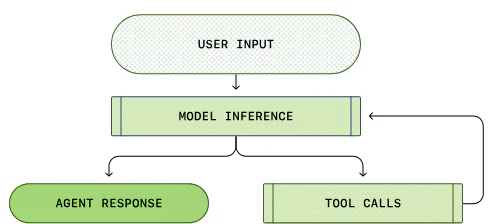
  <figcaption>一个简化的 Codex Agent 循环：Agent 调用工具，工具响应影响模型的下一轮生成。图片来自 OpenAI 的 Codex Agent 文章。</figcaption>
</figure>

### 模式 2：把文件系统作为持久记忆

长期运行的 Agent 系统反复出现一个模式：用简单的控制方式管理丰富的状态与产物。Harness 不应该把完整工作流和全部日志都塞进上下文，而应把持久状态保存在文件里。在长时间运行中，实验日志、代码差异、论文摘要、错误轨迹和过去的 rollout，往往远长于模型训练时使用的上下文窗口。

读写和编辑文件系统——通常通过 shell 命令完成——是 LLM 的基础能力。因此，以文件这种简单形式管理持久记忆，自然能够受益于核心模型能力的提升。

### 模式 3：子 Agent 与后台任务

Harness 可以启动多个子 Agent 并行执行，并监控后台任务。当主 Agent 需要同时搜索多个假设、并发运行实验，或者委派相互隔离的子任务而不污染主上下文时，这种模式很有价值。

此时，父 Agent 需要一个轻量的进程管理器：启动任务、检查日志、取消失败运行，并把结果合并回主线程。关键设计是让并行关系显式且可检查。如果子 Agent 的输出只存在于短暂的聊天上下文中，它们很快会过时且难以发现；如果输出被写成文件、日志和状态记录，模型就能在中断后恢复，并推理自己的执行历史。

### 案例研究：编码 Agent Harness

Claude Code、Codex、OpenCode 和 Cursor 风格 Agent 的主流编码接口已经逐渐稳定。它们通常采用这样的循环：

```text
观察任务与仓库状态
  ↓
规划下一步
  ↓
调用文件、Shell、搜索或外部工具
  ↓
读取工具结果和测试反馈
  ↓
修改代码并再次验证
  └──────────────循环──────────────┘
```

拥有一组工具后，编码 Agent 就能在给定仓库中开发和调试问题，类似人类开发者使用 IDE。

<figure>
  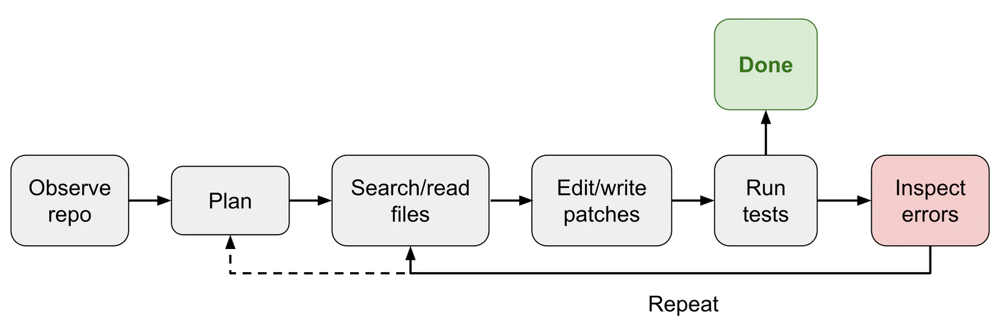
  <figcaption>编码 Agent 可以通过文件、Shell、LSP、Git、MCP、Skills、搜索、产物生成、后台任务和子 Agent 获得行动能力。这里仅作演示，并非完整工具清单。</figcaption>
</figure>

| 工具组 | 常见工具与用途 |
| --- | --- |
| 文件系统 | `glob`、`grep`、`ls` 发现文件；`read`、`read_many` 读取文件；`write` 新建完整文件；`edit` 做精确字符串替换；`multi_edit` 批量编辑；`apply_patch` 应用结构化补丁或 diff |
| Shell 执行 | 运行 `bash`、PowerShell 等命令 |
| 代码与版本状态 | LSP、`git_status`、`git_diff`、`git_commit` 等 Git 工具 |
| 外部上下文 | MCP 工具与 Skills |
| Web 搜索 | `web_search`、`web_fetch`、浏览器工具 |
| 产物 | 读取文档和图片；生成 HTML、图片等交付物 |
| 后台进程 | 例如 `CronCreate`、`CronDelete`、`CronList` |
| Agent 委派 | 例如 `spawn_agent`、`resume_agent`、`wait_agent`、`list_agents`、`close_agent`、`interrupt_agent` |

## Harness 层与核心智能，谁更重要？

未来 RSI 会在多大程度上依赖 Harness 工程，目前很难预测。但近期 RSI 不太可能从“模型直接改写自身权重”开始。作者判断，较实际的短期路径是：

> Harness 工程会朝着元方法论的方向发展，也就是改进“获得更好答案的机器”，而不只是改进答案本身。

Harness 系统本身会成为优化目标，启发式规则会减少，通用机制会增多。成熟的 Harness 反过来支持模型自我改进所需的自动化研究；更聪明的模型则能避免 Harness 过度工程化，让系统保持可持续。

最终，许多 Harness 改进可能会被内化到核心模型行为中，但模型与外部上下文、工具之间的接口仍会存在。提示词工程已经出现过一次较温和的版本：随着指令微调和模型推理能力提升，手工提示技巧不再处于中心位置，但目标、约束、上下文和评估仍然必须被明确表达。

## Harness 优化

Harness 系统中被优化的对象，大致会沿着下面的路径演进：

```text
指令提示词 → 结构化上下文 → 工作流 → Harness 代码 → 优化器代码
```

模型越聪明、能力越强，我们就能把优化目标推向更复杂的对象，并使用更通用的方法。

### 上下文工程

随着 Agent 任务周期显著变长，如果把每一次工具响应和模型生成都不断追加到上下文中，规模会迅速失控。上下文管理层的任务是构造更结构化、更精简的 LLM 上下文，并管理持久状态。长上下文研究毫无疑问会继续进步，但在当前阶段，长上下文智能和上下文工程有时仍然彼此交织。

**Agentic Context Engineering（ACE；Zhang et al. 2025）** 把上下文看作一份不断演化的“作战手册”，而不是不断变长的提示词。它通过三个组件维护由多个条目组成的上下文手册，每个条目都有标识符和描述：

- **Generator（生成器）**：参考条目生成任务轨迹。
- **Reflector（反思器）**：从成功和失败轨迹中提炼洞见。
- **Curator（整理器）**：以增量、逐项条目的形式更新结构化上下文。

<figure>
  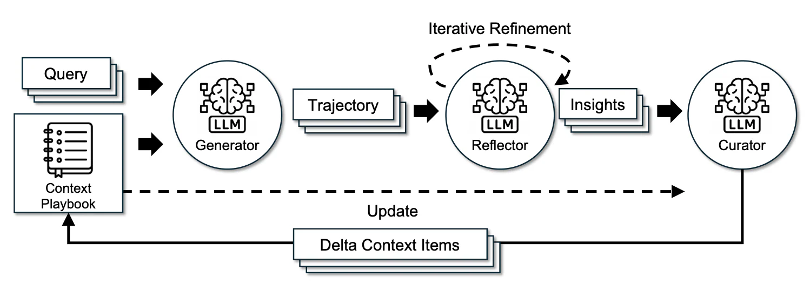
  <figcaption>Agentic Context Engineering（ACE）的框架。图片来自 Zhang et al. 2025。</figcaption>
</figure>

为了避免迭代改写时出现上下文坍塌和“简短偏置”，ACE 的 Curator 不会重写整块提示词。它输出一组结构化的逐项条目 `(identifier, description)`，再通过确定性逻辑把这些条目合并到结构化的上下文日志中。条目会周期性地被细化和去重。

ACE 能从 rollout 中学习洞见，这让我们更接近自我管理的记忆；但它的更新规则和整体工作流仍然由人工设计。为了形成更自我改进的循环，**Meta Context Engineering（MCE；Ye et al. 2026）** 将机制和产物内容分开：在元优化层让技能进化，在基础层优化上下文。

MCE 技能 $s \\in \\mathcal{S}$ 定义上下文函数 $c_s=(\\rho_s,F_s)$，把输入 $x$ 映射为上下文 $c=F_s(x;\\rho_s)$。其中：

- $\\rho_s=\\{\\rho_1,\\dots,\\rho_m\\}$ 是静态组件，例如提示词、知识库和代码库。
- $F_s=\\{F_1,\\dots,F_k\\}$ 是动态算子，例如搜索、选择、过滤和格式化。

双层优化在内层寻找给定技能下最优的上下文，在外层寻找验证集表现最好的技能：

```text
内层：c_s* = arg max J_train(c_s; s)
外层：s*   = arg max J_val(c_s*)
```

技能数据库会记录过去的技能、上下文函数和评估指标：

```text
H_(k-1) = {(s_i, c_i, J_i^train, J_i^val)}，i = 1 ... k-1
```

给定任务 $\\tau$，元层 Agent 对历史技能做 Agentic 交叉，产生新技能：

```text
s_k = crossover(tau, H_(k-1))
```

随后，基础层上下文工程师执行该技能，根据 rollout 反馈 $\\mathcal{R}_k$ 学习上下文函数：

```text
c_k = engineer(tau, s_k; c_(k-1)*, R_k)
```

<figure>
  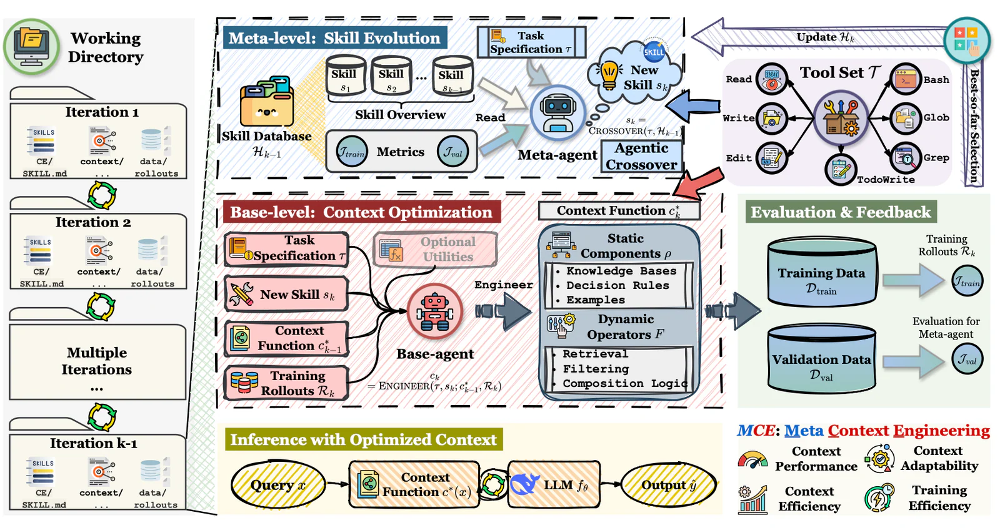
  <figcaption>Meta Context Engineering（MCE）：元层技能进化负责搜索上下文管理机制，基础层负责优化具体任务上下文。图片来自 Ye et al. 2026。</figcaption>
</figure>

MCE 不像 ACE 那样强制指定上下文结构规则。它使用自由形式的技能保存任务中最重要的知识，并让技能与受技能约束的上下文一起迭代。实现上，上下文函数可以实例化为专用目录中的文件集合，同时包含静态组件（如 `skill.md`）和动态组件（如上下文与数据 rollout）。元层和基础层优化都在具有标准工具的 Agentic 编码环境中运行：

```text
T = {Read, Write, Edit, Bash, Glob, Grep, TodoWrite}
```

**Meta-Harness（Lee et al. 2026）** 又向内推进了一层：被优化的对象变成“决定并优化什么信息应该被保存、检索和呈现给模型”的代码。名字中的“Meta”意味着它是一个用来优化 Harness 的 Harness。

创建新 Harness 的 proposer 本身就是一个编码 Agent，最终输出是一组位于帕累托前沿的 Harness 候选。完整执行历史可以通过文件系统访问，因此编码 Agent 可以使用 `grep`、`cat` 等命令阅读历史，而不必把所有内容塞进单个提示词上下文。每个候选 Harness 都是文件系统中的一个字典，包含自身源码、分数、rollout 轨迹和状态更新。Meta-Harness 循环不断创建新 Harness，只保留合格者。

<figure>
  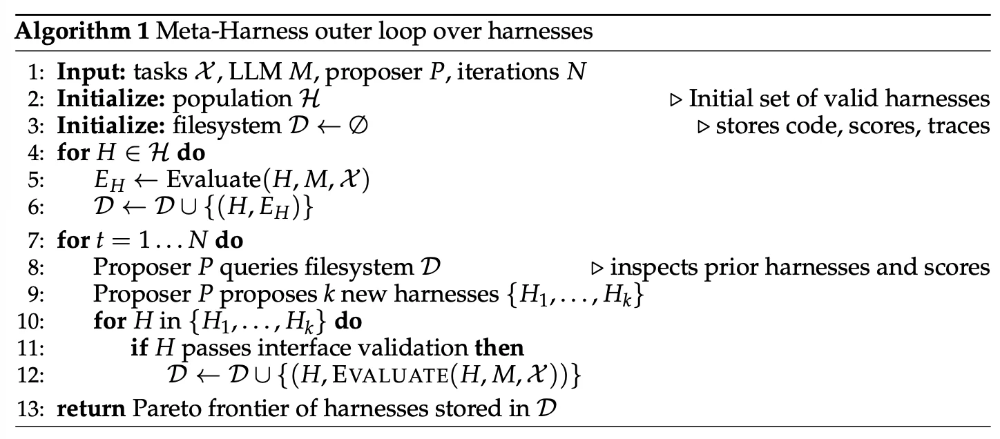
  <figcaption>Meta-Harness 的外层循环优化算法。图片来自 Lee et al. 2026。</figcaption>
</figure>

<figure>
  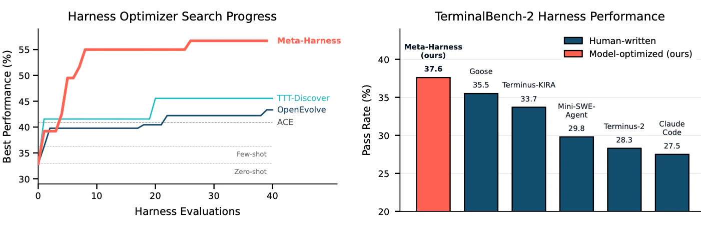
  <figcaption>Meta-Harness 的性能：左侧是少量迭代下的文本分类，右侧是 TerminalBench-2。TerminalBench-2 实验从 Terminus-KIRA 和 Terminus-2 这两个很强的 Harness 初始化。图片来自 Lee et al. 2026。</figcaption>
</figure>

最重要的结论很清楚：一旦 Harness 设计成为可执行的搜索空间，强编码 Agent 就能利用与人类工程师相同的设计空间。

### 工作流设计

Harness 中的工作流可以由领域专家手工设计。以自动化科研为例，研究者已经提出并测试了多种框架。

**AI Scientist（Lu et al. 2026）** 构建了一条流水线，用于提出研究想法、编写代码、运行实验、分析结果、撰写论文并执行同行评审。**ScientistOne（Meng et al. 2026）** 则把可验证性作为核心设计约束：每个主张，无论是引用、数值、方法还是结论，都必须追溯到证据来源，并由 Chain-of-Evidence 检查审计。

<figure>
  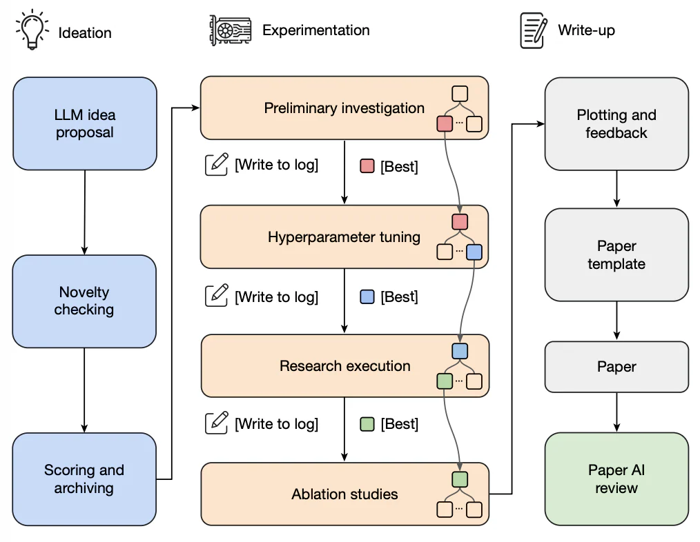
  <figcaption>AI Scientist 用于想法生成、实验、论文写作和评审的流水线。图片来自 Lu et al. 2026。</figcaption>
</figure>

**Autodata（Kulikov et al. 2026）** 被设计为一名生成训练和评估数据的数据科学家。主 Agent 管理四个角色：提出问题的 challenger、弱求解器、强求解器，以及验证器或裁判。目标是在“恰到好处”的难度上合成数据：强求解器能成功，弱求解器会失败。

<figure>
  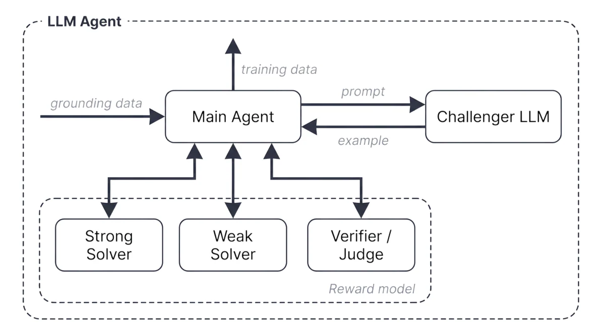
  <figcaption>Autodata 围绕 challenger、solver 和 verifier 生成合成训练与评估数据的 Agentic 工作流。图片来自 Kulikov et al. 2026。</figcaption>
</figure>

Autodata 会根据求解器和验证器的反馈，迭代更新 challenger 提示词。它的限制在于，合成任务被用来微调弱求解器，而不是强求解器。如果这个循环不能迭代改进强模型，它更像是在生成提示分布上进行间接蒸馏，RSI 色彩并不强。

工作流设计空间极其庞大，因此自然可以把工作流设计视为搜索问题：不只依赖人工构建，也可以通过算法寻找好方案。**Automated Design of Agentic Systems（ADAS；Hu et al. 2025）** 把 Agent 设计本身表述为优化问题，也就是“元 Agent 搜索”：由元 Agent 提出新的 Agentic 工作流设计。

ADAS 的流程如下：

1. 用 CoT、Self-Refine 等简单 Agent 初始化工作流档案库。
2. 要求元 Agent 参考档案库中已有方案，用代码编写新的 Agent 工作流。元 Agent 先生成高层描述，再实现代码。
3. 草稿程序经过两个 self-refine 步骤，由模型提供反馈并据此修改，以检查新颖性。
4. 评估每个新候选，把成功者加入档案库。
5. 重复上述过程，直到达到最大迭代次数。

<figure>
  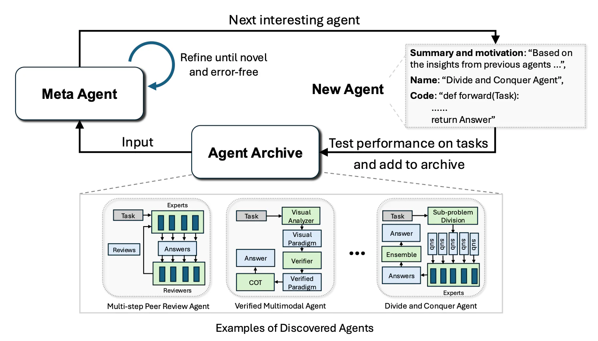
  <figcaption>Automated Design of Agentic Systems（ADAS）示意。图片来自 Hu et al. 2025。</figcaption>
</figure>

**AFlow（Zhang et al. 2025）** 把 Agentic 工作流表示为图：节点代表调用 LLM 的动作，边用代码实现逻辑操作。工作流优化依赖蒙特卡洛树搜索（MCTS）：

1. 用模板初始化树的起始工作流 $W_0$。
2. 根据分数和均匀探索的软混合选择一个工作流节点。
3. 提示 LLM 依据评估表现生成修改后的工作流，从而扩展节点。
4. 执行并评估新工作流。
5. 如果新工作流在 $N$ 轮预算内有所改进，就把它加回树中。
6. 重复第 2 至第 5 步，直到前 $k$ 个平均分数进入平台期或耗尽预算。

<figure>
  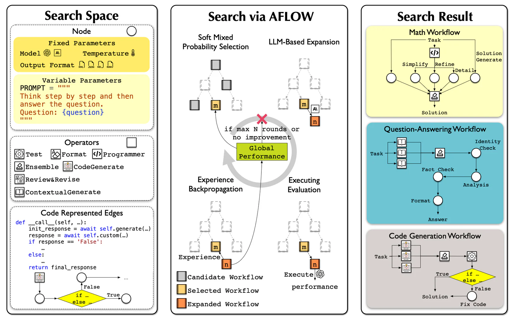
  <figcaption>AFlow 在候选工作流树上的优化过程。图片来自 Zhang et al. 2025。</figcaption>
</figure>

在问答、代码和数学任务上的实验显示，AFlow 相比手工设计的工作流和 ADAS 都有明显提升。

<figure>
  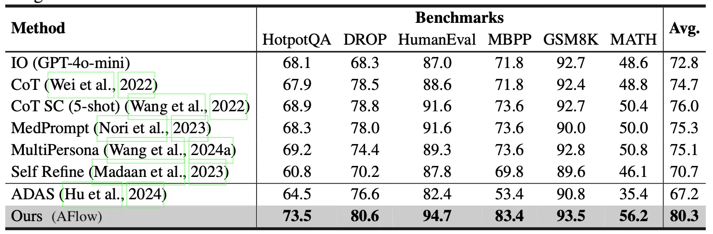
  <figcaption>AFlow 与手工方法和 ADAS 的实验对比。图片来自 Zhang et al. 2025。</figcaption>
</figure>

### 自我改进的 Harness

无论上下文工程还是工作流设计，都只覆盖 Harness 的一部分。我们需要搜索整个设计空间，联合优化上下文管理逻辑、工作流、权限和其他 Harness 组件。Meta-Harness、ADAS 和 AFlow 等工作表明，**代码**是定义程序和系统的通用语言。换言之，Harness 就是一段代码，它规定提示词、工具调用、子 Agent、控制流、记忆和工作流逻辑如何协同。如果 LLM 能优化执行 Agent 的代码，它就能进入比手写提示词大得多的设计空间。

**Self-Taught Optimizer（STOP；Zelikman et al. 2023）** 是较早的递归脚手架改进案例。步骤 $t=0$ 的种子改进器 $I_0$ 接收初始解 $s$、效用函数 $u$ 和黑盒语言模型 $M$，返回改进后的解 $s'$：

```text
s' = I(u, s; M)
```

STOP 的目标不是直接改进解 $s$，而是改进改进器 $I$ 本身。首先，定义元效用为改进器 $I$ 在一组下游任务 $\\mathcal{D}$ 上的平均效用：

```text
u_hat(I) = 1 / |D| * E[(u,s) ~ D][u(I(u,s; M))]
```

由于改进改进器本身也是一个优化问题，可以通过自改进更新，根据 $I_{t-1}$ 的元效用递归得到新版本：

```text
I_t = I_(t-1)(u_hat, I_(t-1); M)
```

<figure>
  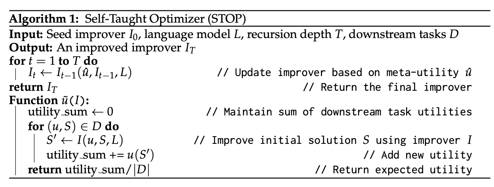
  <figcaption>Self-Taught Optimizer（STOP）的算法。图片来自 Zelikman et al. 2023。</figcaption>
</figure>

实验中，被改进的改进器发现了多种策略，例如遗传算法、分而治之、多臂提示老虎机、模拟退火、温度变化以及 beam/tree search。这与把 Harness 工作流作为优化对象非常相似。

<figure>
  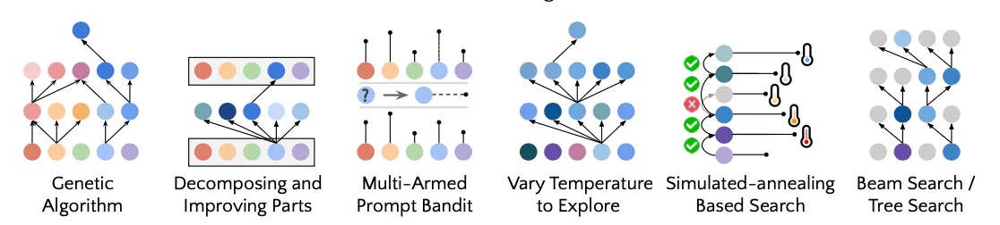
  <figcaption>STOP 发现的部分自我改进策略。图片来自 Zelikman et al. 2023。</figcaption>
</figure>

Zelikman et al.（2023）还给出了一个警示：STOP 使用 GPT-4 时，平均下游性能可以逐轮提升；使用 GPT-3.5、Mixtral 等较弱模型时反而下降。仅有递归结构并不够，基础模型必须足够有能力，才能改进机制。这说明 Harness 改进能让模型部署得更好，但智能仍然是核心。

Lin et al.（2026）进一步研究了 Harness 进化对模型能力的依赖，并拆成两个维度：

- **Harness updating（Harness 更新能力）**：产生有用 Harness 编辑的能力。
- **Harness benefit（Harness 受益能力）**：利用更新后的 Harness 更好解决任务的能力。

实验观察到，从 Qwen3.5-9B 到 Claude Opus 4.6，不同规模和核心智能的模型，Harness 更新能力反而比较接近；9B 的 Harness proposer/evolver 能写出与 Opus 在程序上同构的技能。若要最大化利用 Harness，模型还必须正确且及时地调用技能和工具，并具备良好的长期指令遵循能力。

<figure>
  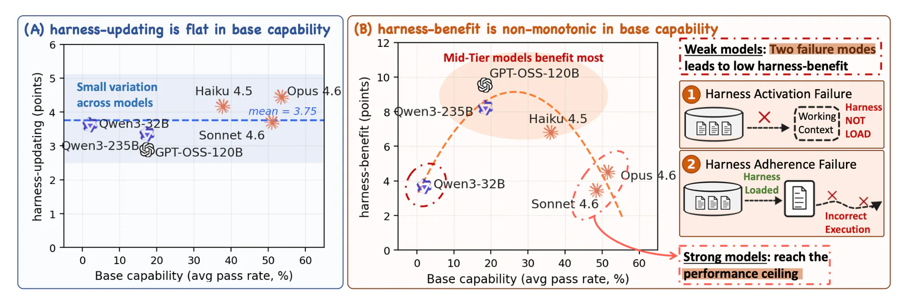
  <figcaption>主要结果：(A) 从 Qwen2-32B 到 Opus 4.6，Harness 更新能力大致持平；(B) Harness 受益能力并非单调，中等层级模型获益最多。图片来自 Lin et al. 2026。</figcaption>
</figure>

较新的 **Self-Harness（Zhang et al. 2026）** 让 LLM Agent 通过“提出—评估—接受”的循环改进自身 Harness。

<figure>
  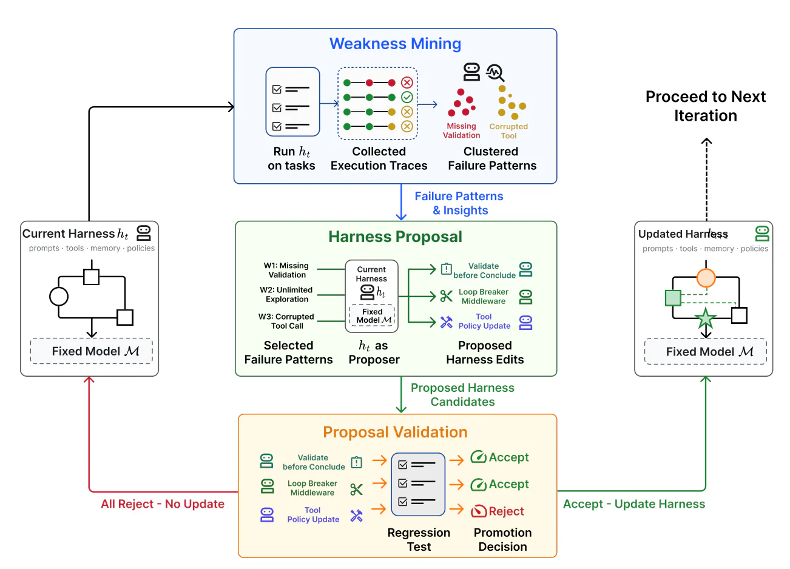
  <figcaption>Self-Harness 通过弱点挖掘、受限 Harness 提案和验证来更新 Harness。图片来自 Zhang et al. 2026。</figcaption>
</figure>

这个循环包含三个阶段：

**1. 弱点挖掘。** 使用当前 Harness $h_t$ 在任务上评估并收集执行轨迹，把失败聚类为“验证器可证实”的失败模式。表面相同的超时或产物缺失，背后可能有不同的因果机制。因此失败记录必须足够丰富，包含验证器层面的最终原因、相关 Agent 行为的因果状态，以及轨迹暴露出的抽象 Agent 机制，才能找到根因。

**2. Harness 提案。** 基于挖掘出的失败模式，提出受约束的 Harness 编辑。由同一个模型在 $h_t$ 下担任 proposer，并提供有限的提案上下文：

- 当前 Harness 的可编辑表面。
- 评估系统给出的失败模式。
- 应该保留的通过行为。
- 过去尝试过的编辑摘要。

Harness 编辑应优先处理能够通过局部修改解决的高频错误；候选编辑要彼此不同且足够多样。

**3. 提案验证。** 评估并合并合格编辑，生成新 Harness $h_{t+1}$。候选编辑会在 held-in 数据 $D_\\text{in}$ 上检查弱点是否解决，并在 held-out 数据 $D_\\text{out}$ 上检查是否引入新问题。只有两边都没有回归的候选才会被接受。通过者合并进 Harness，被拒绝者也保留日志，但不改变当前 Harness。

在 Terminal-Bench-2 上使用 MiniMax M2.5、Qwen3.5-35B-A3B 和 GLM-5 时，Self-Harness 能为不同基础模型学习面向其弱点的 Harness 指令，并提升 held-out 通过率。

不过，这类工作也带来一个担忧：如果程序可以修改操作系统，原有的抽象边界就会被打破。可编辑表面必须经过认真设计，权限控制和安全层必须位于这个循环之外。围绕 reward hacking 的挑战也仍然存在。

**Agentic Harness Engineering（AHE；Lin et al. 2026）** 认为 Harness 进化的瓶颈在可观测性：一次 rollout 失败时，必须知道哪个组件负责；每一次编辑都应建立在证据上。

该框架通过三个可观测性支柱构成闭环：

- **组件可观测性**：每个可编辑 Harness 组件都在文件系统中有对应表示，使动作空间显式且可追溯。Harness 包含七个组件：系统提示词、工具描述、工具实现、中间件、技能、子 Agent 配置和长期记忆。每种失败模式都要映射到一个组件，使编辑更精准。
- **经验可观测性**：把大量原始轨迹分析和总结为分层证据与失败模式。每个 Harness 生成 $k$ 条轨迹，“Agent debugger”逐文件分析轨迹，为每个任务生成关于成功或失败根因的报告；所有任务报告再汇总为 benchmark 概览。需要时可以下钻读取原始轨迹。这种分层访问更节省 token。
- **决策可观测性**：每次编辑都附带下一轮验证的预测。“Evolve agent”阅读仓库，决定编辑哪个组件，并给出编辑及其理由。每次编辑都是一项文件层面的、可证伪的主张，可在下一轮验证。

AHE 有两条关键约束：

1. 编辑只能作用于 Harness workspace。`runs` 目录、tracer、verifier 和 LLM 配置都是只读的，从而禁止关闭验证器、替换模型或提高推理预算等 reward hacking 行为，确保记录的所有收益都能归因到 Harness 编辑。
2. 编辑必须由证据驱动，并附带一份 manifest：失败证据名称、推断出的根因、目标修复，以及预期影响，包括预期修复和可能回归。

在 Terminal-Bench-2 上，AHE 在除 Hard 层和少数自我进化基线之外的多数设置上超过人类设计的 Harness（OpenCode、Terminus-2、Codex）。同一个冻结的 Harness 不继续进化，也能迁移到 SWE-bench-verified，说明进化出的结构可以把工程经验编码进 Harness 组件，而不是只针对某个 benchmark 做特化。

### 进化搜索

进化搜索受自然选择启发：维护一个解群体，通过变异产生后代，只保留适应度高的个体。它在两种情况下特别合适：

1. 搜索空间巨大或形状怪异。
2. 很难直接用梯度优化，但很容易评估解。

Harness 搜索似乎很符合这两个条件。提示词工程早就开始使用进化搜索。**Promptbreeder（Fernando et al. 2023）** 通过丰富的变异操作优化任务提示词，而且用于指示 LLM 怎样变异提示词的“变异提示词”本身也会进化。**GEPA（Agrawal et al. 2025）** 把反思式提示与进化搜索结合，利用自然语言对试错轨迹进行反思，提出提示词更新。

**AlphaEvolve（Novikov et al. 2025）** 是一个编码 Agent 进化搜索系统。它保存候选程序池，提示冻结的 LLM 生成 diff 进行改进；系统反复评估子程序，保留成功者，随着时间发现更好的解。

<figure>
  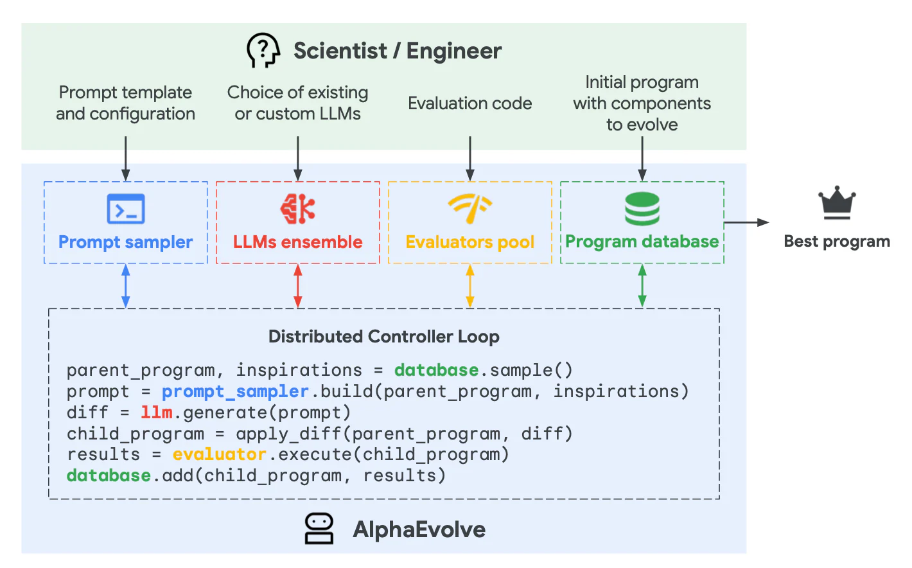
  <figcaption>AlphaEvolve 的工作方式。图片来自 Novikov et al. 2025。</figcaption>
</figure>

AlphaEvolve 有几个关键设计细节：

- 提示中包括父程序、结果、指令，有时还包括元信息。
- 编码 Agent 可以访问完整仓库，但待改进代码区域要用 `# EVOLVE-BLOCK-START` 和 `# EVOLVE-BLOCK-END` 明确标出。
- 由 LLM 建议的元提示词会与指令和上下文共同进化，方式类似解程序的进化。
- 消融实验验证了进化流程、提示上下文、元提示词、整文件进化和更强 LLM 的价值。

<figure>
  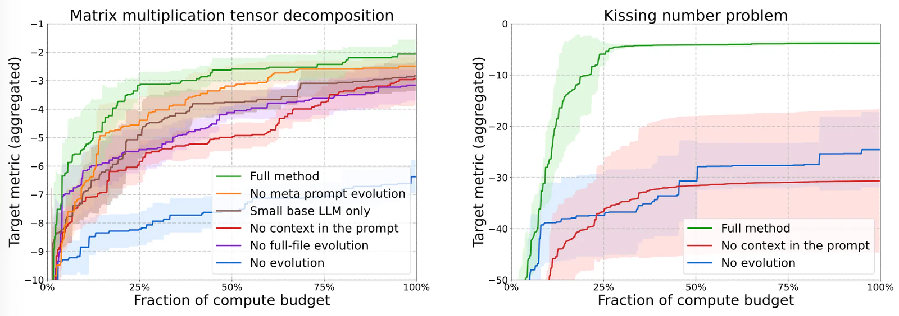
  <figcaption>消融实验显示了 AlphaEvolve 若干设计选择的价值。图片来自 Novikov et al. 2025。</figcaption>
</figure>

近期变体 **ThetaEvolve（Wang et al. 2025）** 把进化搜索、强化学习和上下文学习结合；**DemoEvolve（Che et al. 2026）** 把人类专家示范加入自我 rollout 档案，作为 Harness 层诊断和编辑的参考经验。

**ShinkaEvolve（Lange et al. 2025）** 则通过三个新组件提升 LLM 采样效率：

- 设计父代采样方式，在性能排名和后代数量之间平衡，以实现更高效的探索。
- 基于 embedding 余弦相似度做代码新颖性拒绝采样，丢弃与现有群体过于相似的候选。
- 在 meta-scratchpad 中识别成功解的好模式，指导后续变异。

与上述偏向改进解的方法不同，**Darwin Gödel Machine（DGM；Zhang et al. 2025）** 明确瞄准可编辑 Harness 代码仓库的进化，使用 LLM 编码 Agent 修改自己的 Harness。后续工作 **Hyperagents（Zhang et al. 2026）** 又引入元 Agent，用来控制如何修改现有任务 Agent 以产生新 Agent。

DGM 的流程如下：

1. 初始池中只有一个编码 Agent。
2. 每轮按表现越高、子代越少则概率越大的方式选择一个父代。
3. 父代检查自己的 benchmark 评估日志，提出对自身 Harness 代码库的改进，生成新版编码 Agent。代码编辑只使用两种基础工具：Shell 和 editor。
4. 评估新 Agent，只把表现足够好的个体放回池中。
5. 重复第 2 至第 4 步，直到满足停止条件。

DGM 是在固定基础模型下的 Harness 进化。以 Claude 3.5 Sonnet 为基础模型并使用简单初始 Harness 时，DGM 发现的 Agent 在 SWE-bench Verified 上从 20% 提升到 50%，在 Polyglot 上从 14.2% 提升到 30.7%，达到或超过手工设计 Agent 的表现。

这一类方法在候选解能自动评估、适应度容易量化的领域表现较好，例如矩阵乘法、GPU kernel 优化、算法竞赛和数据中心调度。当评估缓慢、含糊或高度依赖启发式判断时，效果会明显受限；进化的计算效率与有效性同样值得关注。

### 与模型权重联合优化

Harness 进化改变的是模型周围的非参数系统。为了实现完整自我改进，模型也可以同时更新权重。权重更新可以通过改进训练管线实现，也可以通过测试时持续学习实现。

**SIA（Hebbar et al. 2026）** 是较早尝试在同一个优化循环中结合 Harness 改进与模型参数更新的工作，包含三个组件：

- **Meta-Agent**：提出初始 Harness。
- **Task-Specific Agent**：执行任务。
- **Feedback-Agent**：依据近期轨迹，决定下一轮更新 Harness 还是模型权重。

<figure>
  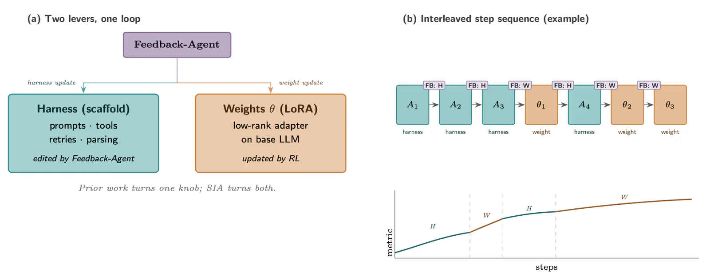
  <figcaption>SIA 中的 Feedback-Agent 决定下一轮是更新 Harness 还是更新权重。图片来自 Hebbar et al. 2026。</figcaption>
</figure>

SIA 的实验存在若干混杂因素，使结果不易解释。例如任务 Agent 比 Meta-Agent 和 Feedback-Agent 使用的模型弱得多（`gpt-oss-120b` 对 Claude Sonnet 4.6），基线也偏弱，难以与其他方法清晰横向比较。作者认为方向很有意思，但证据仍是初步的；训练稳定性、Goodhart 效应等问题仍未解决。

**Continual Harness（Karten et al. 2026）** 则在长期游戏环境中同时实验 Harness 更新和策略模型共学习，通过在低奖励轨迹上蒸馏强教师模型的标签来学习策略。

## 未来挑战

AI Scientist 系列工作证明，专家设计的 Harness 能协调自动化研究回路中的很大一部分，并以写研究论文的形式进行了实验。但“生产论文”并不等于“科学发现”。系统可以写出看似合理的稿件，同时却包含捏造的引用、实现漂移或薄弱的实验结果。

Trehan & Chopra（2026）测试了 LLM 能否只依靠最少的脚手架和基础工具（`read_file`、`write_file`、`llm_search`、`list_files`）从研究想法走到论文。每个想法有独立 workspace，Agent 可以生成和读取文档作为上下文。实验覆盖世界模型、多 Agent RL 和 AI 安全与对齐三个领域，每个领域有 45 至 50 份高质量种子文档。人类专家最终只选出四个想法运行完整流水线，其中只有一个真正完成成文。

实验观察到六种反复出现的失败模式：

- **偏向训练数据默认值**：使用旧库、过时命令、标准格式，或建立在与实际仓库、数据集无关的假设上。
- **执行压力导致实现漂移**：实现变得复杂时，模型会滑向更常见、更简单的方案，而不是原定方法。
- **记忆与上下文退化**：长期项目会丢失关键细节，除非日志被写成持久产物。
- **过度乐观**：即使实验有噪声或失败，模型仍宣称成功。Bubeck et al.（2025）也观察到类似“p-hacking 和 eureka-ing”的模式，模型会用“数值胶带”补漏洞，在信号仍只是噪声时宣布胜利。
- **领域智能不足**：模型缺少隐性工艺知识，例如无法预测实现复杂度、判断实验结果是否合理，或知道哪些基线真正重要。
- **科学品味薄弱**：实验可以执行，但回答的不是正确问题。

研究人员正在向完整 RSI 推进，但仍有若干瓶颈：

### 1. 评估器薄弱且模糊

许多研究主张没有快速、精确的验证器，许多现实任务也是如此。当前自我改进循环最适合那些指标可测量、客观的任务，这与强化学习的工作方式类似。研究品味、新颖性和长期科学价值则很难衡量。研究品味往往混合了问题定义、实验设计，以及判断哪些意外结果值得继续、哪些失败值得重试的能力。

### 2. 上下文和记忆的生命周期

Agent 越自主、越独立，记忆就增长得越快。有用的 Harness 必须管理上下文与记忆，弥补长上下文生成的现有局限，同时提升长期任务的成功率。人类一生都在维护记忆，因此作者认为上下文工程未来可能成为智能的核心部分，而不应一直停留在软件系统层。

### 3. 负面结果

研究者倾向于发表成功结果，导致文献对成功存在偏置。LLM 从海量数据中学习，而数据中的成功与失败案例并不平衡，因此模型可能不擅长决定何时放弃假设、报告负面结果，甚至承认失败。研究 Harness 应让失败尝试容易保存，因为从失败中学习是缩小任务搜索空间的最好方式。

### 4. 多样性坍塌

进化和 RL 循环容易利用已知的高奖励模式，最终塌缩成同一个解决方案的大量变体。开放式研究尤其需要防止这种情况，因为最佳路径在早期可能反而表现更差。

### 5. Reward hacking

自我改进循环会优化它收到的任何信号。如果奖励来自单元测试，Agent 可能过拟合测试；如果来自裁判模型，它可能学会针对该裁判的作弊技巧；如果来自 benchmark 分数，它可能利用 benchmark 伪影。

评估器和权限控制很可能应该位于 Harness 进化循环之外，并使用 held-out 测试、轨迹审计和关键决策点的人类审查。监督能够扩展到什么程度、自动化到什么程度，仍是开放问题。

### 6. 长期成功

外部的优化循环依据训练沙盒中可以模拟的单次 rollout 之外的目标工作。以编码 Agent 为例，它们已经提升了软件工程的日常效率，但许多优化目标仍然过于短期。Agent 经常能完成眼前任务，却不知道怎样维护由数百或数千名工程师共同维护的仓库的长期健康。标准的沙盒式 RLVR 训练很少能捕捉可维护性、所有权边界、迁移成本、向后兼容性和未来调试负担。

### 7. 人类角色

人类应该向上移动一层，而不是被移出循环。人类需要在正确时间、正确抽象层次提供监督，系统设计也应当考虑在哪些触点、以什么方式引入人类。

上述许多挑战都需要人的反馈和引导。毕竟，我们是在为人类更好的未来建设技术，而不是反过来。

## 调研结论：一图理解 Harness 研究谱系

下面这张图是整理者根据全文补充的概念地图，不属于原论文正文。图中的方法并不是互相替代关系：它们分别在优化上下文、工作流、Harness 自身和模型权重。越往右侧，优化对象通常越接近完整的自我改进系统。

<figure>
  <svg viewBox="0 0 1200 840" role="img" aria-labelledby="harness-map-title harness-map-desc" style="display:block;width:100%;height:auto;">
    <title id="harness-map-title">Harness 与递归自我改进研究谱系</title>
    <desc id="harness-map-desc">递归自我改进分为上下文、工作流、Harness 自身和模型权重四条优化路线，并由搜索算法、评估与验证基础设施共同支撑。</desc>

    <rect x="420" y="16" width="360" height="60" rx="16" fill="#11130f" />
    <text x="600" y="53" text-anchor="middle" fill="#ffffff" font-size="22" font-weight="700">Recursive Self-Improvement</text>

    <path d="M600 76 V96 M162 96 H1038 M162 96 V118 M450 96 V118 M738 96 V118 M1038 96 V118"
          fill="none" stroke="#9ba096" stroke-width="2" />
    <path d="M162 112 L156 101 L168 101 Z M450 112 L444 101 L456 101 Z M738 112 L732 101 L744 101 Z M1038 112 L1032 101 L1044 101 Z"
          fill="#9ba096" />

    <g font-family="Segoe UI, sans-serif">
      <rect x="32" y="118" width="260" height="76" rx="14" fill="#fff3bf" stroke="#d9ae16" stroke-width="2" />
      <text x="162" y="148" text-anchor="middle" fill="#11130f" font-size="20" font-weight="700">改上下文</text>
      <text x="162" y="173" text-anchor="middle" fill="#63685f" font-size="14">模型每一轮看到什么</text>

      <rect x="320" y="118" width="260" height="76" rx="14" fill="#e8eeff" stroke="#8ba4ee" stroke-width="2" />
      <text x="450" y="148" text-anchor="middle" fill="#11130f" font-size="20" font-weight="700">改工作流</text>
      <text x="450" y="173" text-anchor="middle" fill="#63685f" font-size="14">按什么步骤执行任务</text>

      <rect x="608" y="118" width="260" height="76" rx="14" fill="#f0f1ec" stroke="#aeb3aa" stroke-width="2" />
      <text x="738" y="148" text-anchor="middle" fill="#11130f" font-size="20" font-weight="700">改 Harness 自身</text>
      <text x="738" y="173" text-anchor="middle" fill="#63685f" font-size="14">系统怎样修改自己的运行结构</text>

      <rect x="908" y="118" width="260" height="76" rx="14" fill="#f5e7e2" stroke="#c89583" stroke-width="2" />
      <text x="1038" y="148" text-anchor="middle" fill="#11130f" font-size="20" font-weight="700">改模型权重</text>
      <text x="1038" y="173" text-anchor="middle" fill="#63685f" font-size="14">参数和能力是否同步更新</text>
    </g>

    <g font-family="Segoe UI, sans-serif">
      <rect x="32" y="220" width="260" height="66" rx="12" fill="#ffffff" stroke="#dfe2db" />
      <text x="52" y="247" fill="#11130f" font-size="18" font-weight="700">ACE</text>
      <text x="52" y="270" fill="#63685f" font-size="13">从轨迹增量整理上下文手册</text>

      <path d="M162 286 V304" stroke="#b6bab2" stroke-width="2" />
      <path d="M162 304 L156 294 L168 294 Z" fill="#b6bab2" />
      <rect x="32" y="304" width="260" height="66" rx="12" fill="#ffffff" stroke="#dfe2db" />
      <text x="52" y="331" fill="#11130f" font-size="18" font-weight="700">MCE</text>
      <text x="52" y="354" fill="#63685f" font-size="13">进化“怎样管理上下文”的技能</text>

      <path d="M162 370 V388" stroke="#b6bab2" stroke-width="2" />
      <path d="M162 388 L156 378 L168 378 Z" fill="#b6bab2" />
      <rect x="32" y="388" width="260" height="66" rx="12" fill="#ffffff" stroke="#dfe2db" />
      <text x="52" y="415" fill="#11130f" font-size="18" font-weight="700">Meta-Harness</text>
      <text x="52" y="438" fill="#63685f" font-size="13">优化保存、检索与呈现信息的代码</text>

      <rect x="320" y="220" width="260" height="66" rx="12" fill="#ffffff" stroke="#dfe2db" />
      <text x="340" y="247" fill="#11130f" font-size="18" font-weight="700">AI Scientist</text>
      <text x="340" y="270" fill="#63685f" font-size="13">专家设计端到端科研流程</text>

      <path d="M450 286 V304" stroke="#b6bab2" stroke-width="2" />
      <path d="M450 304 L444 294 L456 294 Z" fill="#b6bab2" />
      <rect x="320" y="304" width="260" height="66" rx="12" fill="#ffffff" stroke="#dfe2db" />
      <text x="340" y="331" fill="#11130f" font-size="18" font-weight="700">ADAS</text>
      <text x="340" y="354" fill="#63685f" font-size="13">搜索并生成 Agent 工作流代码</text>

      <path d="M450 370 V388" stroke="#b6bab2" stroke-width="2" />
      <path d="M450 388 L444 378 L456 378 Z" fill="#b6bab2" />
      <rect x="320" y="388" width="260" height="66" rx="12" fill="#ffffff" stroke="#dfe2db" />
      <text x="340" y="415" fill="#11130f" font-size="18" font-weight="700">AFlow</text>
      <text x="340" y="438" fill="#63685f" font-size="13">把工作流表示为图并用 MCTS 搜索</text>

      <rect x="608" y="220" width="260" height="58" rx="12" fill="#ffffff" stroke="#dfe2db" />
      <text x="628" y="245" fill="#11130f" font-size="18" font-weight="700">STOP</text>
      <text x="628" y="266" fill="#63685f" font-size="13">改进器递归地改进自己</text>

      <rect x="608" y="294" width="260" height="58" rx="12" fill="#ffffff" stroke="#dfe2db" />
      <text x="628" y="319" fill="#11130f" font-size="18" font-weight="700">Self-Harness</text>
      <text x="628" y="340" fill="#63685f" font-size="13">弱点挖掘、受限修改、回归验证</text>

      <rect x="608" y="368" width="260" height="58" rx="12" fill="#ffffff" stroke="#dfe2db" />
      <text x="628" y="393" fill="#11130f" font-size="18" font-weight="700">AHE</text>
      <text x="628" y="414" fill="#63685f" font-size="13">组件可观测性与证据驱动修改</text>

      <rect x="608" y="442" width="260" height="58" rx="12" fill="#ffffff" stroke="#dfe2db" />
      <text x="628" y="467" fill="#11130f" font-size="18" font-weight="700">DGM</text>
      <text x="628" y="488" fill="#63685f" font-size="13">进化完整的 Harness 代码仓库</text>

      <rect x="908" y="220" width="260" height="66" rx="12" fill="#ffffff" stroke="#dfe2db" />
      <text x="928" y="247" fill="#11130f" font-size="18" font-weight="700">SIA</text>
      <text x="928" y="270" fill="#63685f" font-size="13">决定修改 Harness 还是更新权重</text>

      <rect x="908" y="304" width="260" height="66" rx="12" fill="#ffffff" stroke="#dfe2db" />
      <text x="928" y="331" fill="#11130f" font-size="18" font-weight="700">Continual Harness</text>
      <text x="928" y="354" fill="#63685f" font-size="13">长期任务中的在线共学习</text>
    </g>

    <rect x="32" y="566" width="1136" height="104" rx="16" fill="#fff8d6" stroke="#d9ae16" stroke-width="2" />
    <g font-family="Segoe UI, sans-serif">
      <text x="56" y="600" fill="#11130f" font-size="18" font-weight="700">通用搜索与进化工具</text>
      <text x="56" y="630" fill="#4d514a" font-size="15">Promptbreeder · GEPA · AlphaEvolve · ShinkaEvolve · ThetaEvolve · DemoEvolve</text>
      <text x="56" y="653" fill="#6d7269" font-size="13">它们不是独立优化层，而是可以被不同层用来搜索提示词、代码或 Harness 候选。</text>
    </g>

    <rect x="32" y="700" width="1136" height="82" rx="16" fill="#ffffff" stroke="#cfd3cb" />
    <g font-family="Segoe UI, sans-serif">
      <text x="56" y="732" fill="#11130f" font-size="18" font-weight="700">自我改进的共同基础设施</text>
      <text x="56" y="760" fill="#5f645b" font-size="14">可执行评估 · held-out 回归 · 轨迹可观测 · 权限隔离 · 人类监督</text>
    </g>

    <text x="600" y="818" text-anchor="middle" fill="#63685f" font-family="Segoe UI, sans-serif" font-size="14">
      越往右：越不只是修改提示词，越接近系统级的递归自我改进
    </text>
  </svg>
  <figcaption>Harness 研究的四条优化路线与两项共同基础。搜索算法负责提出候选，评估、观测和权限边界负责阻止系统通过“钻指标空子”获得虚假进步。</figcaption>
</figure>

快速判断一项工作属于哪一层，可以先问三个问题：

1. **它改的是什么？** 如果只改变模型看到的信息，主要是上下文工程；如果改变任务步骤，是工作流设计。
2. **它会不会修改“产生方案的机制”？** ACE 主要优化上下文内容；MCE 优化管理上下文的技能；Meta-Harness、Self-Harness、AHE 和 DGM 才开始优化生成或运行方案的系统。
3. **它有没有更新模型参数？** 只改提示词、上下文或代码时，通常仍是非参数改进；SIA 和 Continual Harness 才进一步尝试把 Harness 更新与权重或策略学习结合。

最后可以用一句话记住这张图：

> ACE 管上下文，MCE 管“怎样管理上下文”，Meta-Harness 优化 Harness 代码，ADAS/AFlow 搜索工作流，STOP/Self-Harness/AHE/DGM 让 Harness 修改自身，AlphaEvolve 等方法提供搜索工具，SIA 再把模型权重拉进同一个改进闭环。

## 引用

原文引用格式：

> Weng, Lilian. “Harness Engineering for Self-Improvement.” *Lil'Log* (Jul 2026). https://lilianweng.github.io/posts/2026-07-04-harness/

BibTeX：

```bibtex
@article{weng2026harness,
  title = {Harness Engineering for Self-Improvement},
  author = {Weng, Lilian},
  journal = {lilianweng.github.io},
  year = {2026},
  month = {July},
  url = {https://lilianweng.github.io/posts/2026-07-04-harness/}
}
```

## 附录：一些有用的基准

**PaperBench**：从零复现 20 篇 ICML 2024 Spotlight 和 Oral 论文，包括理解论文贡献、开发代码库并成功执行实验。每个复现任务被拆成多个可单独评分的子任务，总共有 8,316 条评分规则，由论文作者共同设计。当时最佳模型 Claude 3.5 Sonnet 约 21%，没有超过机器学习博士。另有 PaperBench Code-Dev 轻量版和 JudgeEval。

**CORE-Bench**：评估已发表研究的计算可复现性。包含来自计算机科学、社会科学和医学的 90 篇论文、共 270 个任务。任务要求使用提供的代码和数据复现结果，包含多个难度层，以及纯语言和视觉语言两类任务。当时最佳 Agent（GPT-4o 与 GPT-4o-mini）在最难任务上的准确率只有 21%。

**ScienceAgentBench**：评估用于数据驱动科学发现的 LLM Agent。从数学、化学、生物学、地理学四个领域的 44 篇同行评审论文中提取 102 个任务，覆盖数据处理、模型开发、数据分析与信息可视化。

**RE-Bench**：在真实 ML 研究工程环境中将前沿 Agent 与人类专家对比。包含 7 个高难度开放式环境，每个环境由打分函数、起始解和参考解组成，可使用不超过 8 块 H100 GPU。常见任务包括优化 kernel、运行 scaling-law 实验、修复 embedding 和为问答微调 GPT-2。数据包括 61 位专家完成的 71 次八小时尝试。专家在 82% 的八小时尝试中得分非零，24% 至少追平强参考解。最佳 AI Agent 在两小时预算下得分约为人类的四倍，但人类对更长预算的收益更高，在八小时和三十二小时设置下超过 Agent。

**MLE-bench**：在离线 Kaggle 竞赛中评估机器学习工程 Agent。包含 75 个 Kaggle ML 工程竞赛，测试训练模型、准备数据集、运行实验和提交预测，以公开排行榜作为人类基线。论文中的最佳配置是 `o1-preview + AIDE scaffolding`，在 16.9% 的竞赛中达到至少 Kaggle 铜牌水平。

**KernelBench**：评估生成 GPU kernel 的正确性和速度。包含 250 个 PyTorch 任务，核心指标 `fast_p` 表示生成 kernel 既正确又比基线更快的百分比。

## 参考文献

1. Good, I. J. “Speculations Concerning the First Ultraintelligent Machine.” *Advances in Computers*, 6:31–88, 1965.
2. Yudkowsky, Eliezer. “Recursive Self-Improvement.” LessWrong, 2008.
3. Choi et al. “Anchored Self-Play for Code Repair.” ICML 2026.
4. Zhao et al. “Absolute Zero: Reinforced Self-play Reasoning with Zero Data.” arXiv:2505.03335, 2025.
5. Yuan et al. “Self-Rewarding Language Models.” arXiv:2401.10020, 2024.
6. Chen et al. “Self-Play Fine-Tuning Converts Weak Language Models to Strong Language Models.” ICML 2024.
7. Zhang et al. “Agentic Context Engineering: Evolving Contexts for Self-Improving Language Models.” ICLR 2026.
8. Ye et al. “Meta Context Engineering via Agentic Skill Evolution.” arXiv:2601.21557, 2026.
9. Lee et al. “Meta-Harness: End-to-End Optimization of Model Harnesses.” arXiv:2603.28052, 2026.
10. Lu et al. “Towards end-to-end automation of AI research.” *Nature*, 651:914–919, 2026.
11. Meng et al. “ScientistOne: Towards Human-Level Autonomous Research via Chain-of-Evidence.” arXiv:2605.26340, 2026.
12. Kulikov et al. “Autodata: An agentic data scientist to create high quality synthetic data.” arXiv:2606.25996, 2026.
13. Hu, Lu, and Clune. “Automated Design of Agentic Systems.” ICLR 2025.
14. Madaan et al. “Self-Refine: Iterative Refinement with Self-Feedback.” NeurIPS 2023.
15. Zhang et al. “AFlow: Automating Agentic Workflow Generation.” ICLR 2025.
16. Zelikman et al. “Self-Taught Optimizer (STOP): Recursively Self-Improving Code Generation.” COLM 2024.
17. Zhang et al. “Self-Harness: Harnesses That Improve Themselves.” arXiv:2606.09498, 2026.
18. Fernando et al. “Promptbreeder: Self-Referential Self-Improvement Via Prompt Evolution.” arXiv:2309.16797, 2023.
19. Agrawal et al. “GEPA: Reflective Prompt Evolution Can Outperform Reinforcement Learning.” arXiv:2507.19457, 2025.
20. Novikov et al. “AlphaEvolve: A coding agent for scientific and algorithmic discovery.” arXiv:2506.13131, 2025.
21. Lange, Imajuku, and Cetin. “ShinkaEvolve: Towards Open-Ended And Sample-Efficient Program Evolution.” arXiv:2509.19349, 2025.
22. Wang et al. “ThetaEvolve: Test-time Learning on Open Problems.” arXiv:2511.23473, 2025.
23. Zhang et al. “Darwin Gödel Machine: Open-Ended Evolution of Self-Improving Agents.” arXiv:2505.22954, 2025.
24. Zhang et al. “Hyperagents.” arXiv:2603.19461, 2026.
25. Yuksekgonul et al. “Learning to Discover at Test Time.” arXiv:2601.16175, 2026.
26. Riaz et al. “Epistemic Uncertainty for Test-Time Discovery.” arXiv:2605.11328, 2026.
27. Hebbar et al. “SIA: Self Improving AI with Harness & Weight Updates.” arXiv:2605.27276, 2026.
28. Trehan and Chopra. “Why LLMs Aren't Scientists Yet: Lessons from Four Autonomous Research Attempts.” arXiv:2601.03315, 2026.
29. Bubeck et al. “Early science acceleration experiments with GPT-5.” arXiv:2511.16072, 2025.
30. Starace et al. “PaperBench: Evaluating AI's Ability to Replicate AI Research.” ICML 2025.
31. Wijk et al. “RE-Bench: Evaluating frontier AI R&D capabilities of language model agents against human experts.” ICML 2025.
32. Chan et al. “MLE-bench: Evaluating Machine Learning Agents on Machine Learning Engineering.” arXiv:2410.07095, 2024.
33. Chen et al. “ScienceAgentBench: Toward Rigorous Assessment of Language Agents for Data-Driven Scientific Discovery.” ICLR 2025.
34. Siegel et al. “CORE-Bench: Fostering the Credibility of Published Research Through a Computational Reproducibility Agent Benchmark.” TMLR 2024.
35. Ouyang et al. “KernelBench: Can LLMs Write Efficient GPU Kernels?” arXiv:2502.10517, 2025.
36. Lin et al. “Harness Updating Is Not Harness Benefit: Disentangling Evolution Capabilities in Self-Evolving LLM Agents.” arXiv:2605.30621, 2026.
37. Lin et al. “Agentic Harness Engineering: Observability-Driven Automatic Evolution of Coding-Agent Harnesses.” arXiv:2604.25850, 2026.
38. Karten et al. “Continual Harness: Online Adaptation for Self-Improving Foundation Agents.” arXiv:2605.09998, 2026.
39. Che et al. “DemoEvolve: Overcoming Sparse Feedback in Agentic Harness Evolution with Demonstrations.” arXiv:2605.24539, 2026.
